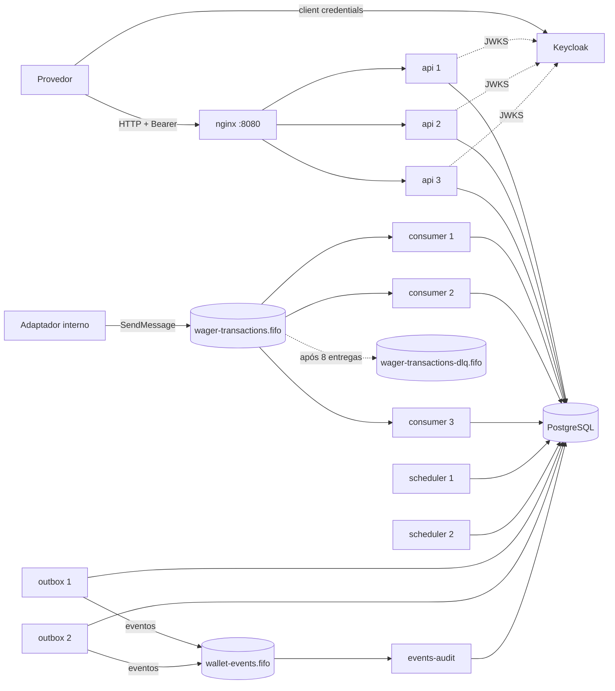
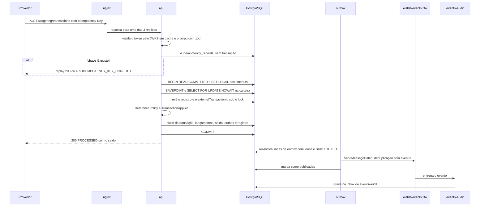
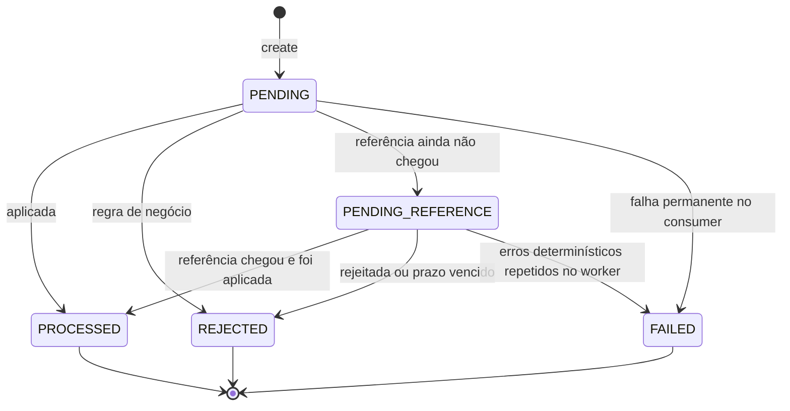

# Arquitetura

Aqui eu explico como o serviço funciona por dentro, por que tomei cada decisão, o que testei e descartei, e onde estão os limites. Sempre que falo de uma garantia, aponto o teste que a prova. Setup e comandos estão no [README.md](README.md).

## 1. Resumo

O serviço é uma carteira de apostas no modelo seamless wallet. Provedores de jogos mandam `BET`, `WIN`, `LOSS`, `REFUND` e `ROLLBACK` por HTTP ou por uma fila SQS FIFO. Cada operação vira uma única transação do PostgreSQL, que grava junto:

- a linha da transação;
- os lançamentos do ledger, em partidas dobradas;
- o novo saldo da carteira;
- o registro de idempotência;
- os eventos da outbox.

Decidi que o PostgreSQL é a fonte da verdade de tudo. Idempotência, ordem, unicidade e imutabilidade ficam em lock de linha, constraints e triggers. O SQS é só transporte. Um código só e uma imagem só sobem seis papéis (api, consumer, outbox, scheduler, events-audit e migrate), quase todos com várias réplicas ao mesmo tempo. Dinheiro é `bigint` em centavos no código, `numeric(20,2)` no banco e string decimal nos contratos.



| Serviço        | Réplicas      | O que faz                                                                                  |
| -------------- | ------------- | ------------------------------------------------------------------------------------------ |
| `migrate`      | 1, roda e sai | aplica as migrations como `jungle_owner`; os outros serviços só sobem depois dele          |
| `queues-init`  | 1, roda e sai | cria as três filas e a redrive policy                                                      |
| `api`          | 3             | API HTTP, atrás do nginx em round-robin                                                    |
| `consumer`     | 3             | lê `wager-transactions.fifo` e chama o mesmo caso de uso da api                            |
| `outbox`       | 2             | publica a outbox em `wallet-events.fifo`                                                   |
| `scheduler`    | 2             | resolve as transações `PENDING_REFERENCE`, roda a reconciliação global e amostra os gauges |
| `events-audit` | 1             | consumidor de exemplo dos eventos; grava cada evento uma vez, deduplicando por `eventId`   |
| `postgres`     | 1             | PostgreSQL 17, com os bancos `jungle` e `keycloak`                                         |
| `ministack`    | 1             | emulador de SQS                                                                            |
| `keycloak`     | 1             | Identity Provider (realm `jungle`)                                                         |

Com o perfil `observability`, sobem também `prometheus`, `grafana` e `jaeger` (seção 15).

Todo serviço de aplicação sobe um servidor HTTP mínimo com `/health/live`, `/health/ready` e `/metrics`. O `test/e2e/replicas.test.ts` manda 300 BETs pelo nginx e confere nos logs que as três réplicas da api atenderam.

Tratei a fila de entrada como canal interno. Quem publica nela é o adaptador de integração da plataforma, não o provedor direto. Neste repositório esse papel é feito pelos testes e pelo `bun run provider:simulate`.

### O caminho de uma BET



Pela fila o caminho é o mesmo, com dois passos a mais. O consumer consulta a inbox antes de tudo e grava a linha dela dentro da mesma transação do efeito. A mensagem só é apagada da fila depois do commit.

## 2. Garantia, mecanismo e teste

Os testes de integração e de concorrência rodam contra PostgreSQL e MiniStack de verdade, em containers do testcontainers. Nenhum deles usa mock de repositório ou de cliente SQS, e a checagem `check-test-mocks` reprova se alguém tentar. Todo teste fora de `test/unit` termina com um `afterEach` global que confere, em todo banco criado pelo teste, que o saldo de cada carteira bate com o ledger (`test/support/ledger-consistency.ts`).

Além dos testes de cada parte, montei a pasta `test/compliance/` com uma prova curta e direta para cada restrição do enunciado. São 11 arquivos: `r5-1` a `r5-9` (uma por restrição inviolável), `r2-auth` e `e14-eliminatory`. O `test/e2e/` roda contra o Compose inteiro. No CI, o job `compliance` gera um JUnit e o `scripts/compliance/report.ts` monta uma tabela com o resultado de cada linha no resumo da execução.

As regras estáticas que cito como C-xx rodam no lint e no `bun run check:compliance`:

| Código | Regra                                                                                                     | Onde                                                                                 |
| ------ | --------------------------------------------------------------------------------------------------------- | ------------------------------------------------------------------------------------ |
| C-01   | nenhum comentário em código, config, SQL, shell ou YAML                                                   | `eslint-rules/no-comments.js`, `scripts/compliance/check-non-ts-comments.ts`         |
| C-02   | dinheiro nunca é `number`                                                                                 | `eslint-rules/money-no-number.js`                                                    |
| C-03   | domínio e aplicação não importam ORM, Nest, AWS nem infraestrutura                                        | `no-restricted-imports` em `eslint.config.js`                                        |
| C-04   | nenhum estado de módulo (cache em memória) na aplicação e na infraestrutura; nenhuma dependência de cache | `eslint-rules/no-module-state.js`, `scripts/compliance/check-dependencies.ts`        |
| C-05   | só o worker do outbox importa o publicador de eventos                                                     | `no-restricted-imports` em `eslint.config.js`                                        |
| C-06   | nenhuma dependência proibida pelo enunciado                                                               | `scripts/compliance/check-dependencies.ts`                                           |
| C-07   | nenhum `UPDATE` ou `DELETE` em `ledger_entries` no código                                                 | `scripts/compliance/check-sql-literals.ts`                                           |
| C-08   | nenhum `LOCK TABLE`, advisory lock ou `FOR UPDATE` sem `WHERE`                                            | `scripts/compliance/check-sql-literals.ts`                                           |
| C-09   | toda migration tem `up` e `down`                                                                          | `scripts/compliance/check-migrations.ts`                                             |
| C-10   | nenhum mock de banco ou fila nos testes de integração, concorrência, conformidade e e2e                   | `scripts/compliance/check-test-mocks.ts`                                             |
| C-11   | nenhuma tabela de senha nem biblioteca de hash de senha ou JWT próprio                                    | `scripts/compliance/check-dependencies.ts`, `scripts/compliance/check-migrations.ts` |
| C-12   | toda rota HTTP declara `@Roles` ou `@Public`                                                              | `eslint-rules/controller-access.js`                                                  |

### Invariantes

| Garantia                                                                      | Mecanismo                                                                                                                                                                     | Onde está provado                                                                                                                                                                                                                                                                                        |
| ----------------------------------------------------------------------------- | ----------------------------------------------------------------------------------------------------------------------------------------------------------------------------- | -------------------------------------------------------------------------------------------------------------------------------------------------------------------------------------------------------------------------------------------------------------------------------------------------------- |
| INV-01: saldo nunca fica negativo                                             | `Wallet.debit` recusa com `INSUFFICIENT_FUNDS`; o débito roda sob o lock da carteira; `wallets_balance_non_negative_ck` e `ledger_entries_balances_non_negative_ck` no banco  | `test/unit/domain/wallet/wallet.test.ts`, `test/integration/persistence/constraints.test.ts`, `test/concurrency/competing-bets.test.ts`, `test/concurrency/reversal-funds-race.test.ts`                                                                                                                  |
| INV-02: nada é debitado ou creditado duas vezes                               | registro de idempotência por `(provider_id, idempotency_key)`, releitura sob o lock, uniques `wager_transactions_provider_key_uq` e `wager_transactions_provider_external_uq` | `test/concurrency/same-bet-50x.test.ts`, `test/integration/wagering/external-id-race.test.ts`, `test/concurrency/crash-after-commit-before-ack.test.ts`                                                                                                                                                  |
| INV-03: toda mudança de saldo tem exatamente um lançamento de carteira        | triggers JG002 (cadeia de versões da carteira) e JG003 (lançamento coerente com a transação); `ledger_entries_one_per_wallet_uq` e `ledger_entries_wallet_version_uq`         | `test/integration/persistence/guards.test.ts`, `test/integration/persistence/constraints.test.ts`                                                                                                                                                                                                        |
| INV-04: saldo da carteira igual ao saldo reconstruído pelo ledger             | JG002 confere no commit; reconciliação por carteira e global; checagem no `afterEach` de todo teste                                                                           | `test/integration/support/ledger-consistency.test.ts`, `test/integration/reconciliation/reconcile-wallet.test.ts`, `test/integration/reconciliation/reconcile-divergence.test.ts`, `test/integration/reconciliation/global-reconciliation.test.ts`, `test/concurrency/reconciliation-under-load.test.ts` |
| INV-05: lançamento nunca é alterado nem apagado                               | trigger JG001; `jungle_app` sem `UPDATE`, `DELETE` nem `TRUNCATE` em `ledger_entries`; regra C-07 no código                                                                   | `test/integration/persistence/guards.test.ts`, `test/integration/persistence/migrations.test.ts`, `test/unit/compliance/check-sql-literals.test.ts`, `test/compliance/r5-5-ledger-immutable.test.ts`                                                                                                     |
| INV-06: carteira + casa somam zero em cada transação                          | `LedgerPosting` só nasce balanceado; trigger JG004 (`ledger_entries_transaction_balance`)                                                                                     | `test/unit/domain/wallet/ledger-posting.test.ts`, `test/integration/persistence/guards.test.ts`                                                                                                                                                                                                          |
| INV-07: transação terminal nunca muda                                         | transições explícitas em `WagerTransaction`; trigger JG005; grants só nas colunas de status                                                                                   | `test/unit/domain/wagering/wager-transaction.test.ts`, `test/integration/persistence/guards.test.ts`                                                                                                                                                                                                     |
| INV-08: uma carteira por `playerId` + moeda, nunca apagada                    | `wallets_player_currency_uq`; trigger JG006; sem grant de `DELETE`                                                                                                            | `test/integration/http/wallets.http.test.ts`, `test/integration/persistence/constraints.test.ts`, `test/integration/persistence/guards.test.ts`                                                                                                                                                          |
| INV-09: uma referência é revertida no máximo uma vez, somando os dois tipos   | `ReferencePolicy` checa "já revertida" sob o lock; unique parcial `wager_transactions_single_reversal_uq`                                                                     | `test/unit/domain/wagering/reference-policy.test.ts`, `test/integration/wagering/reversals.test.ts`, `test/concurrency/reversal-before-reference.test.ts`                                                                                                                                                |
| INV-10: nenhum evento sai antes do commit e nenhum evento confirmado se perde | outbox na mesma transação do efeito; publicador separado que só enxerga linhas commitadas; lease; deduplicação FIFO pelo `eventId`; regra C-05                                | `test/integration/outbox/outbox-atomicity.test.ts`, `test/integration/outbox/outbox-crash.test.ts`, `test/integration/resilience/atomicity.test.ts`, `test/integration/resilience/unavailability.test.ts`, `test/integration/resilience/restart.test.ts`, `test/concurrency/two-publishers.test.ts`      |
| INV-11: mesma chave com payload diferente nunca vira replay                   | hash do payload comparado no fast path e de novo sob o lock                                                                                                                   | `test/unit/domain/idempotency/idempotency-record.test.ts`, `test/integration/wagering/submit.test.ts`, `test/concurrency/same-key-different-payload.test.ts`                                                                                                                                             |
| INV-12: tudo isso vale com três ou mais instâncias                            | nenhum estado em memória; lock por linha; leases no banco para os workers                                                                                                     | `test/concurrency/multi-instance.test.ts`, `test/compliance/r5-8-multi-instance.test.ts`, `test/concurrency/restart-consistency.test.ts`, `test/e2e/replicas.test.ts`, `test/e2e/failover.e2e.test.ts`                                                                                                   |

### Restrições invioláveis (§5 do enunciado)

Cada linha tem uma prova dedicada em `test/compliance/` e as provas espalhadas pelas outras pastas.

| Restrição                                        | Mecanismo                                                                                                                                                                                                                                     | Onde está provado                                                                                                                                                                                                                          |
| ------------------------------------------------ | --------------------------------------------------------------------------------------------------------------------------------------------------------------------------------------------------------------------------------------------- | ------------------------------------------------------------------------------------------------------------------------------------------------------------------------------------------------------------------------------------------ |
| 5.1 sem `number` para dinheiro                   | `Money` com `bigint`; regra de lint `money-no-number` (identificador de dinheiro não pode ser `number`; `parseFloat`, `toFixed`, `Math.round` e `setTypeParser` proibidos); schema recusa `"amount": 10` como número; colunas `numeric(20,2)` | `test/compliance/r5-1-no-number-money.test.ts`, `test/unit/domain/shared/money.test.ts`, `test/unit/compliance/money-no-number.rule.test.ts`, `test/integration/http/validation.http.test.ts`, `test/integration/sqs/consumer.dlq.test.ts` |
| 5.2 sem cache em memória para idempotência       | registro e inbox só no PostgreSQL; regra `no-module-state` proíbe estado de módulo e `Map`/`Set` como campo em `application` e `infrastructure`; dependências de cache recusadas                                                              | `test/compliance/r5-2-persistent-idempotency.test.ts`, `test/unit/compliance/no-module-state.rule.test.ts`, `test/unit/compliance/check-dependencies.test.ts`, `test/integration/resilience/atomicity.test.ts`                             |
| 5.3 não depender só do FIFO                      | lock da carteira no banco serializa; inbox e registro de idempotência deduplicam                                                                                                                                                              | `test/compliance/r5-3-not-only-fifo.test.ts`, `test/concurrency/broker-not-guarantee.test.ts`, `test/integration/sqs/consumer.redelivery.test.ts`                                                                                          |
| 5.4 não publicar antes do commit                 | outbox; só o worker do outbox importa o publicador (C-05)                                                                                                                                                                                     | `test/compliance/r5-4-publish-after-commit.test.ts`, `test/integration/outbox/outbox-atomicity.test.ts`, `test/unit/compliance/restricted-imports.test.ts`                                                                                 |
| 5.5 ledger nunca sobrescrito nem apagado         | JG001, grants, C-07                                                                                                                                                                                                                           | `test/compliance/r5-5-ledger-immutable.test.ts`, `test/integration/persistence/guards.test.ts`, `test/integration/persistence/migrations.test.ts`                                                                                          |
| 5.6 sem lock global                              | lock só na linha da carteira; C-08 proíbe `LOCK TABLE`, advisory lock e `FOR UPDATE` sem `WHERE`                                                                                                                                              | `test/compliance/r5-6-no-global-lock.test.ts`, `test/concurrency/parallel-wallets.test.ts`, `test/unit/compliance/check-sql-literals.test.ts`                                                                                              |
| 5.7 sem `read → calculate → update` sem controle | `SELECT ... FOR UPDATE` antes de ler o saldo; `WHERE version = ?` no update como segunda barreira                                                                                                                                             | `test/compliance/r5-7-no-read-calc-update.test.ts`, `test/concurrency/competing-bets.test.ts`, `test/integration/persistence/wallet-repository.test.ts`                                                                                    |
| 5.8 correto com várias instâncias                | a mesma carga em 1 api + 1 consumer e em 3 apis + 3 consumers dá o mesmo resultado, campo a campo                                                                                                                                             | `test/compliance/r5-8-multi-instance.test.ts`, `test/concurrency/multi-instance.test.ts`                                                                                                                                                   |
| 5.9 garantias no schema                          | as constraints e índices únicos do schema (um caso de teste por constraint), sete guardas (`JG001`–`JG007`), grants por coluna                                                                                                                | `test/compliance/r5-9-schema-guarantees.test.ts`, `test/integration/persistence/constraints.test.ts`, `test/integration/persistence/guards.test.ts`, `test/integration/persistence/migrations.test.ts`                                     |

### Falhas eliminatórias (§14 do enunciado)

O `test/compliance/e14-eliminatory.test.ts` tem um caso curto para cada uma, com duas apis em processos separados:

- 10 BETs paralelas numa carteira de 50.00: cinco aceitas, saldo 0.00, nenhum `balance_after` negativo;
- a mesma BET 10 vezes: um débito;
- 10 `ROLLBACK`s da mesma BET: um crédito;
- replay depois de matar e reiniciar as apis;
- outbox numa transação aberta não é publicada;
- reconciliação consistente;
- a mesma chave com 10 payloads diferentes em paralelo: um efeito e nove 409.

| Falha                                       | Por que não acontece                                                                                          | Onde mais está provado                                                                               |
| ------------------------------------------- | ------------------------------------------------------------------------------------------------------------- | ---------------------------------------------------------------------------------------------------- |
| `number` para dinheiro                      | `Money` com `bigint`, lint type-aware, schema estrito                                                         | `test/unit/compliance/money-no-number.rule.test.ts`, `test/integration/http/validation.http.test.ts` |
| saldo negativo por corrida                  | lock da carteira + CHECK no banco                                                                             | `test/concurrency/competing-bets.test.ts`, `test/compliance/r5-7-no-read-calc-update.test.ts`        |
| débito ou crédito duplicado                 | idempotência persistida + uniques + inbox                                                                     | `test/concurrency/same-bet-50x.test.ts`, `test/concurrency/crash-after-commit-before-ack.test.ts`    |
| idempotência só em memória                  | nada em memória; o replay sobrevive ao reinício do processo                                                   | `test/integration/resilience/atomicity.test.ts`, `test/concurrency/restart-consistency.test.ts`      |
| correto só com uma instância                | estado todo no banco                                                                                          | `test/compliance/r5-8-multi-instance.test.ts`, `test/concurrency/multi-instance.test.ts`             |
| evento publicado antes do commit            | outbox                                                                                                        | `test/integration/outbox/outbox-atomicity.test.ts`                                                   |
| ledger não auditável                        | ledger em partidas dobradas, imutável, com saldo antes e depois e versão                                      | `test/integration/persistence/guards.test.ts`, `test/integration/http/ledger.http.test.ts`           |
| testes que trocam PostgreSQL e SQS por mock | containers reais; `check-test-mocks` recusa `mock.module`, `spyOn` em repositório e fakes fora de `test/unit` | `test/unit/compliance/check-test-mocks.test.ts`, `test/support/preload.ts`                           |

### Cenários de concorrência (§13 do enunciado)

São 12 arquivos em `test/concurrency/`: os 8 cenários que o enunciado pede e 4 extras que eu quis ter. Todos sobem processos reais (`bun src/bootstrap/main-*.ts`) com PostgreSQL e MiniStack em containers.

| Cenário                                         | Arquivo                                                  | O que medi                                                                                                                                                                                                                                                     |
| ----------------------------------------------- | -------------------------------------------------------- | -------------------------------------------------------------------------------------------------------------------------------------------------------------------------------------------------------------------------------------------------------------- |
| 1. mesma aposta 50 vezes em paralelo            | `test/concurrency/same-bet-50x.test.ts`                  | 3 apis e 3 consumers; 25 cópias por HTTP e 25 pela fila. Sempre um débito só, um par de lançamentos, um registro de idempotência; as outras 49 viram replay                                                                                                    |
| 2. duas BETs disputando o mesmo saldo           | `test/concurrency/competing-bets.test.ts`                | saldo 100, duas BETs de 80 em 2 apis: sempre uma `PROCESSED` e uma `REJECTED INSUFFICIENT_FUNDS`, saldo final 20.00; 10 de 10 execuções passaram                                                                                                               |
| 3. carteiras distintas em paralelo              | `test/concurrency/parallel-wallets.test.ts`              | 20 carteiras × 25 operações, 500 requisições juntas: saldos exatos. Uma BET por carteira em paralelo deu `lock_conflicts_total{type="contended"}` = 0 em todas as execuções                                                                                    |
| 4. três ou mais instâncias                      | `test/concurrency/multi-instance.test.ts`                | 3 apis, 3 consumers, 2 outbox, 2 schedulers, 60 operações metade HTTP e metade fila: resultado igual ao da execução em série, campo a campo                                                                                                                    |
| 5. worker morto depois do commit e antes do ack | `test/concurrency/crash-after-commit-before-ack.test.ts` | consumer morre com SIGKILL depois de confirmar k mensagens (k = 1 e 4 nas rodadas); os consumers que sobem depois recebem a reentrega, contam k duplicatas na inbox e k replays, e nada é aplicado duas vezes                                                  |
| 6. dois publishers na mesma outbox              | `test/concurrency/two-publishers.test.ts`                | 500 eventos, um publisher congelado com SIGSTOP e morto com SIGKILL segurando lease de 10 a 50 linhas: os 500 chegam ao events-audit, cada `eventId` uma vez                                                                                                   |
| 7. `REFUND`/`ROLLBACK` antes da referência      | `test/concurrency/reversal-before-reference.test.ts`     | 16 carteiras, reversões antes da BET e junto com ela, por HTTP e fila: em toda carteira uma reversão aplicada e a outra `REFERENCE_ALREADY_REVERSED`, saldo de volta ao inicial                                                                                |
| 8. reinício com consistência final              | `test/concurrency/restart-consistency.test.ts`           | 9 processos mortos juntos com SIGKILL no meio da carga (61 a 69 operações já gravadas) e reiniciados: cada operação com uma linha `PROCESSED`, dois lançamentos e um evento; convergência em 3,0 a 3,7 s                                                       |
| extra: mesma chave, payloads diferentes         | `test/concurrency/same-key-different-payload.test.ts`    | 12 BETs com a mesma chave em 3 apis: uma 200 e onze 409 `IDEMPOTENCY_KEY_CONFLICT`, um par de lançamentos                                                                                                                                                      |
| extra: o broker não é a garantia                | `test/concurrency/broker-not-guarantee.test.ts`          | 30 operações em 15 grupos FIFO diferentes na mesma carteira: 30 `PROCESSED`, versão +30; 29 das 30 esperaram o lock, ou seja, quem serializou foi o banco                                                                                                      |
| extra: reconciliação sob carga                  | `test/concurrency/reconciliation-under-load.test.ts`     | 3 apis e 2 consumers, 60 operações por HTTP e 40 pela fila na mesma carteira, com reconciliações rodando em volta o tempo todo: toda reconciliação sai consistente. No mesmo arquivo, 10 criações da mesma carteira por api resultam numa carteira só          |
| extra: disputa de saldo nas reversões           | `test/concurrency/reversal-funds-race.test.ts`           | `WIN`s, `ROLLBACK`s desses `WIN`s e `BET`s disputando uma carteira com pouco saldo, e o `ROLLBACK` de um `WIN` já gasto correndo contra créditos e apostas pequenas: o saldo nunca fica negativo e a reversão sem saldo vira `INSUFFICIENT_FUNDS_FOR_REVERSAL` |

## 3. Persistência

### 3.1 Por que MikroORM

O enunciado deixa escolher entre MikroORM e TypeORM e pede justificativa. Antes de escolher, listei o que o caminho crítico precisa do ORM:

- transação explícita com nível de isolamento escolhido;
- lock pessimista com e sem espera;
- controle de versão no update;
- ordem correta dos INSERTs entre tabelas com FK;
- um jeito de mapear o banco sem sujar as classes de domínio.

Escolhi o MikroORM 6 com `@mikro-orm/postgresql`. O que eu uso dele:

- `em.transactional(work, { isolationLevel })` como fronteira da transação, no `MikroOrmUnitOfWork`;
- `LockMode.PESSIMISTIC_WRITE_OR_FAIL` (`FOR UPDATE NOWAIT`) e `LockMode.PESSIMISTIC_WRITE` (`FOR UPDATE`);
- `version: true` na carteira, que vira `UPDATE ... WHERE id = ? AND version = ?` e incrementa sozinho;
- Unit of Work com flush único: o ORM ordena os INSERTs pelas relações (`wager_transactions` antes de `ledger_entries`);
- `EntitySchema`, que mapeia classes de persistência sem decorator nenhum.

Cada requisição, mensagem, item de worker e tentativa ganha um `EntityManager` novo (fork). Nenhum repositório usa o EM global; todos recebem o da transação corrente.

O que descartei:

- TypeORM. Também tem transação e lock pessimista, mas não tem um Unit of Work de verdade. Cada `save` é uma ida ao banco, e a ordem dos INSERTs fica por conta de quem chama. E o caminho mais usado é decorar as próprias classes, o que puxa o ORM para dentro do domínio.
- SQL puro com `pg`. Daria controle total, mas o enunciado exige ORM, e eu teria que reescrever identity map, ordem de flush e controle de versão.

O ORM fica em `src/infrastructure/persistence` e não aparece em `domain` nem em `application` (regra C-03, checada no lint). Algumas coisas ficaram em SQL nativo pelo `em.execute`, cada uma por um motivo: `SET LOCAL`, `SAVEPOINT`, claims e renovação de lease com `SKIP LOCKED`, `INSERT ... ON CONFLICT DO NOTHING` (contas da casa e inbox), `EXISTS` sob o lock, leitura da view do ledger, somas da reconciliação e o wake-up das pendentes. Linha vinda de SQL nativo passa por um schema zod antes de virar objeto.

Um detalhe que me custou caro descobrir: o `em.execute` cola os valores escapados no texto em vez de usar parâmetros do protocolo. Então nada de `?` dentro de literal.

Outro, de instalação: o `bunfig.toml` usa `linker = "isolated"`. Com o layout hoisted, o `@mikro-orm/migrations` recebia o `ajv` 6 que o ESLint traz, em vez do 8 de que ele precisa, e não carregava.

### 3.2 Records, mappers e `rehydrate`

O enunciado pede construtor privado, fábricas estáticas e um `rehydrate` que reconstrói o estado salvo sem revalidar transições. Só que o MikroORM hidrata entidades sem passar por fábrica nenhuma: ele cria o objeto e preenche os campos.

Por isso decidi que o ORM nunca vê as classes de domínio. Cada tabela tem um record em `src/infrastructure/persistence/records/` e um `EntitySchema` em `schemas/`. Os mappers em `mappers/` fazem `toDomain(record)` (que chama `Wallet.rehydrate`, `WagerTransaction.rehydrate` etc.) e `toRecord(domain, existing?)`. FKs são `ManyToOne` com referência, para o Unit of Work saber a ordem dos INSERTs.

Considerei mapear direto as classes de domínio. O ORM chamaria o construtor sem argumentos ou pularia a fábrica, e o domínio teria que expor construtor público ou campos mutáveis. Não quis.

O custo é um par de arquivos a mais por tabela, em troca de um domínio sem nenhuma dependência de ORM. Linha corrompida que não passa no mapper vira erro determinístico, nunca um objeto meio montado. O `test/unit/infrastructure/persistence/mappers.test.ts` cobre a ida e a volta, e o `test/integration/persistence/entity-schemas.test.ts` confere os schemas contra o banco real.

### 3.3 Mapeamento do `Money`

Dinheiro não pode passar por ponto flutuante em lugar nenhum: nem no código, nem no driver, nem no JSON, nem no ORM. Esse último eu só descobri no fim.

Como ficou:

- No domínio, `Money` guarda `bigint` em centavos e a moeda. Operações exigem a mesma moeda (`CurrencyMismatchError`).
- No contrato, o valor é string decimal com exatamente duas casas (`"25.00"`). O schema de entrada recusa número, mais de duas casas, notação científica e moeda fora da lista configurada (`SUPPORTED_CURRENCIES`, por padrão `BRL,USD,EUR`).
- No banco, `numeric(20,2)`. O `pg` devolve string, e `Money.fromPersistence` converte a string direto para `bigint`, sem passar por `Number`.
- No `EntitySchema`, as colunas de dinheiro usam um tipo próprio, `ExactDecimalType` (`src/infrastructure/persistence/types/exact-decimal.type.ts`), que guarda e compara o valor como string.
- O maior valor que cabe na coluna é o teto do `Money`. Um crédito que passaria dele é rejeitado com `BALANCE_LIMIT_EXCEEDED`, em vez de estourar como erro técnico no banco.

**O bug do `ExactDecimalType`.** Antes eu usava `type: 'decimal'` com `runtimeType: 'string'`. Parecia suficiente, porque o valor chegava como string. Mas o MikroORM, na hora de decidir se a coluna mudou, compara decimal como número. Com saldo a partir de uns 9e13, dois valores diferentes viram o mesmo `double`. O ORM achava que o saldo não tinha mudado e não mandava o `UPDATE`. O lançamento entrava, o saldo não, e o JG002 recusava o commit. Para o provedor, isso aparecia como 503. Os testes de borda no teto da coluna (`999999999999999999.99`, debitar 0,01 de uma carteira cheia e reverter) pegaram isso. Com o `ExactDecimalType`, a comparação é de string e o problema sumiu. Os casos ficaram em `test/integration/http/business-rules.http.test.ts`, `test/integration/persistence/wallet-repository.test.ts` e `test/integration/persistence/wager-transaction-repository.test.ts`.

O que descartei:

- `setTypeParser` do `pg` para `numeric`. Muda o comportamento do driver para o processo inteiro, e o lint proíbe.
- Coluna `bigint` em centavos. Funcionaria, mas `numeric(20,2)` deixa o ledger legível em SQL, e os CHECK de aritmética (`balance_after = balance_before + amount`) ficam na mesma unidade do contrato.
- Bibliotecas decimais (`decimal.js`, `big.js`). `bigint` em centavos resolve sem dependência, e elas estão na lista de proibidas.

Nenhum identificador de dinheiro pode ser `number`, e o lint confere isso com tipos (`money-no-number`). O único lugar da API onde aparece valor negativo é a `difference` da reconciliação.

### 3.4 Estratégia transacional

Uma operação financeira precisa ver o último estado commitado depois de esperar o lock. Não pode ficar presa para sempre num banco travado. E não pode deixar transação aberta se o processo morrer.

Montei três tipos de transação, todos no `MikroOrmUnitOfWork`:

| Tipo          | Abertura                                                                                                     | Usada em                                                                           |
| ------------- | ------------------------------------------------------------------------------------------------------------ | ---------------------------------------------------------------------------------- |
| escrita       | `READ COMMITTED`, `SET LOCAL lock_timeout = '3s'`, `statement_timeout = '5s'`, `transaction_timeout = '15s'` | criar carteira, submeter transação, caminho de `FAILED`, resolver pendente         |
| curta         | `READ COMMITTED`, `lock_timeout = '1s'`, `statement_timeout = '2s'`                                          | claims e renovação de lease, marcar publicado, contabilidade de erro, events-audit |
| reconciliação | `REPEATABLE READ READ ONLY`, `statement_timeout = '60s'`, pool próprio                                       | reconciliação por carteira e global                                                |

Do lado do cliente, quis que um banco congelado gerasse erro em vez de silêncio: 2 s para conectar e para pegar conexão do pool, `query_timeout` de 6 s (acima do `statement_timeout`), `keepAlive` ligado e `idle_in_transaction_session_timeout` de 20 s na sessão. A reconciliação tem pool de 2 conexões com `query_timeout` de 65 s.

O que descartei:

- `SERIALIZABLE`. O lock da carteira já serializa o que importa, e serializable trocaria espera por falhas de serialização que precisariam de retry.
- `REPEATABLE READ` na escrita. Depois de esperar o lock, a transação continuaria vendo o snapshot antigo, e a releitura do registro de idempotência sob o lock não veria o commit de quem segurava o lock. É exatamente isso que o `READ COMMITTED` me dá.
- Sem timeouts. Um lock esquecido ou um banco pausado deixaria requisições penduradas e conexões do pool presas.

`lock_timeout` estourado vira `TRANSIENT` (503 com `Retry-After: 1` no HTTP, backoff na fila). Falta de conexão e timeout de query viram `CONNECTIVITY` (503 com `Retry-After: 5`, e na fila o circuit breaker abre). O `test/integration/persistence/unit-of-work.test.ts` confere o nível de isolamento, cada `SET LOCAL` e os timeouts do cliente.

**Pool e `max_connections`.** No começo todo processo tinha pool de 20, e o PostgreSQL estava com o padrão de 100 conexões. Com 11 réplicas, a conta não fechava. Rodei uma carga curta e vi 5,6% e 9,8% de respostas 503 nas duas rodadas. Parte vinha do pool esgotado e parte do PostgreSQL recusando conexão com `53300` (`too_many_connections`), que nem estava classificado: caía como erro inesperado. Fiz duas mudanças:

- O classificador passou a tratar toda a classe `53xxx` (recursos insuficientes) como `TRANSIENT`, que responde 503 `INFRASTRUCTURE_UNAVAILABLE` com `Retry-After: 1` (`test/integration/persistence/pg-error-classifier.test.ts`).
- Dimensionei o pool por serviço no Compose: api 20, consumer 15, outbox 5, scheduler 5, events-audit 12, cada um com mais 2 da reconciliação. O Keycloak ficou com 20, e o PostgreSQL com `max_connections=300`. Com todos os pools cheios, a conta dá 183: 159 da aplicação, 20 do Keycloak, 1 do migrate e 3 reservadas ao superusuário. O `test/unit/infra/docker-compose.test.ts` refaz essa conta e quebra se alguém mudar uma réplica ou um pool sem caber no limite.

Depois disso, a mesma carga curta deu 0% de 503.

### 3.5 Quem é dono da versão

A carteira tem `version`. Ela ordena o ledger (`wallet_version`) e serve de segunda barreira contra update concorrente. Se domínio e ORM calculassem a versão cada um por conta própria, os dois poderiam divergir sem ninguém perceber.

Deixei o MikroORM como dono. O INSERT não manda `version` (o banco aplica `DEFAULT 1`), o mapper nunca escreve `version` num update, e o ORM gera `WHERE version = ?` e incrementa. Depois do flush, o repositório confere que a versão salva é a mesma que o domínio calculou. Se não for, é erro determinístico.

Pensei em deixar o domínio escrever a versão, mas aí o ORM perderia o controle otimista, e um update sem lock passaria.

Um `OptimisticLockError` só aconteceria se alguém atualizasse a carteira sem o lock. Isso é classificado como `TRANSIENT` e contado em `lock_conflicts_total{type="version_mismatch"}`. O `test/integration/persistence/wallet-repository.test.ts` prova os dois lados: a versão vem do default da coluna, e um update concorrente feito sem lock é recusado.

## 4. Concorrência

### 4.1 Lock pessimista por carteira

Várias réplicas de api e consumer podem receber operações da mesma carteira ao mesmo tempo, inclusive cópias da mesma operação. O enunciado proíbe lock global e `read → calculate → update` sem controle.

A unidade de concorrência que escolhi é a carteira. Toda escrita financeira faz `SELECT ... FOR UPDATE` na linha da carteira, em `READ COMMITTED`, antes de ler qualquer coisa que dependa dela. Sob o lock rodam juntos:

- a releitura do registro de idempotência;
- a checagem do `externalTransactionId`;
- a busca e a validação da referência;
- a checagem de reversão única;
- o cálculo do saldo e a gravação de tudo.

O que descartei:

- Lock otimista com retry. Numa carteira disputada (50 apostas paralelas, ou uma carteira quente de verdade), cada conflito volta para o começo. Isso vira tempestade de retries e, quando o limite de tentativas acaba, falha espúria de uma operação válida.
- Update condicionado (`UPDATE wallets SET balance = balance - x WHERE balance >= x`). Resolve o saldo, mas não serializa a idempotência, a referência e a reversão única, que dependem de ler outras tabelas no mesmo estado.
- Lock de tabela ou advisory lock global. O enunciado proíbe, e isso mataria o paralelismo entre carteiras.

Na prática, operações da mesma carteira entram numa fila no próprio PostgreSQL em vez de falhar. Carteiras diferentes não se esperam: no cenário 3, 20 BETs em 20 carteiras deram zero disputas de lock. A defesa em profundidade continua lá: `WHERE version = ?` no update, `CHECK balance >= 0` e os triggers.

### 4.2 `NOWAIT` com savepoint para medir a disputa

Eu queria saber quando uma carteira está quente. Para isso, preciso distinguir "peguei o lock na hora" de "esperei".

O repositório abre `SAVEPOINT wallet_lock` e tenta `FOR UPDATE NOWAIT`. Se conseguir, segue. Se vier `55P03`, faz `ROLLBACK TO SAVEPOINT` (sem isso a transação inteira ficaria abortada), soma 1 em `lock_conflicts_total{type="contended"}` e tenta de novo com `FOR UPDATE` normal, que espera até o `lock_timeout`. O tempo total vai para `wallet_lock_wait_seconds`.

Considerei só `FOR UPDATE` com espera, que funciona igual mas não deixa contar disputa. Ler `pg_locks` seria caro e sujeito a corrida.

Custa uma ida a mais ao banco quando há disputa. Em troca, a métrica mostra quem serializou: no cenário extra de 15 grupos FIFO na mesma carteira, 29 de 30 operações contaram `contended`. O `test/integration/persistence/wallet-repository.test.ts` prova que o `55P03` é absorvido pelo savepoint e a transação continua usável.

### 4.3 Ordem dos locks e por que não há deadlock

Duas transações que pegam os mesmos locks em ordem diferente podem travar uma à outra. Para evitar isso, toda transação de escrita segue a mesma ordem:

1. linha de `inbox_messages` (inserção ou espera da unique), só no canal SQS;
2. linha de `wallets`, e uma carteira só por transação;
3. locks implícitos: `FOR KEY SHARE` das FKs em `house_accounts` e na transação referenciada, esperas de unique em `wager_transactions` e `idempotency_records`;
4. linhas de `pending_reference_retries` (o wake-up das dependentes).

Leases de outbox, de pendentes e de jobs são reivindicados em transações curtas separadas, que não seguram nenhum desses locks. `house_accounts` só recebe `FOR KEY SHARE`, que é compatível consigo mesmo, e nunca `UPDATE`: a conta da casa não tem saldo materializado (seção 12). As contas da casa são criadas sempre na ordem `GAMING` → `FUNDING`.

Pensei em travar a carteira e a casa juntas, mas a conta da casa viraria um ponto quente que serializaria todas as carteiras da mesma moeda.

Como uma transação nunca trava duas carteiras, não existe ciclo possível entre carteiras. Se algum `40P01` aparecer mesmo assim, o PostgreSQL detecta, e o erro é tratado como `TRANSIENT`.

## 5. Idempotência

### 5.1 A chave do provedor é a fonte da verdade

O mesmo pedido pode chegar várias vezes, por HTTP, pela fila ou pelos dois. Uma chave reaproveitada com outro conteúdo é erro do provedor e não pode virar replay.

Separei em duas perguntas, com duas chaves, as duas no PostgreSQL e na mesma transação do efeito:

- "Esta operação de negócio já foi decidida?" → `idempotency_records`, chave `(provider_id, idempotency_key)`, comparada pelo hash do payload. Vale nos dois canais.
- "Esta mensagem da fila já foi tratada?" → `inbox_messages`, chave `(consumer_name, message_id)`, comparada pelo hash da inbox. Só na fila.

A chave é escopada por provedor: a mesma `Idempotency-Key` vinda de dois provedores são duas operações.

O que descartei:

- Cache em memória ou Redis. O enunciado proíbe como garantia, e se perde no reinício. Não existe cache em nenhum ponto desse caminho.
- Deduplicar só pelo `externalTransactionId`. O enunciado define a `Idempotency-Key` como fonte da verdade. O `externalTransactionId` também é único por provedor, mas como segunda barreira (seção 5.4).
- Confiar na deduplicação do SQS FIFO. A janela é de 5 minutos e só pega a mesma mensagem com o mesmo dedup id.

O preço é retenção para sempre: o registro de idempotência e a inbox nunca são apagados (seção 18).

Dois detalhes do header que eu testei de propósito (`test/integration/http/idempotency-edge.http.test.ts`): espaço nas pontas da chave é cortado pelo parser HTTP, então a chave com espaço é a mesma chave; e o header repetido na mesma requisição responde 400 `MISSING_IDEMPOTENCY_KEY` sem gravar nada, porque não dá para saber qual das duas o provedor quis mandar.

### 5.2 O hash do payload

`payloadHash = sha256(utf8(canonicalJson(subset)))`, em hex minúsculo com 64 caracteres.

- `subset` tem exatamente estes campos: `providerId`, `externalTransactionId`, `playerId`, `walletId`, `roundId`, `gameId`, `kind`, `money { amount, currency }` e `referenceExternalTransactionId` (só se vier).
- Ficam de fora: a própria `Idempotency-Key`, `messageId`, `occurredAt`, `type`, `correlationId`, headers e qualquer metadado de transporte. Por isso HTTP e fila geram o mesmo hash para a mesma operação.
- `canonicalJson`: chaves ordenadas por code unit UTF-16 em todos os níveis, sem espaços, campo ausente omitido. Strings saem como no `JSON.stringify`. `null`, número e qualquer outro tipo fazem a função lançar erro. Isso nunca acontece com entrada válida, porque o schema recusa `null` e não existe número nos contratos.
- Nenhuma normalização de valor. Como a entrada exige exatamente duas casas decimais, `"25.00"` só tem uma forma escrita, e o hash não depende de reformatar nada.

O vetor de referência, que o `test/unit/application/services/payload-hash.test.ts` confere byte a byte, é a BET do enunciado:

```json
{
  "providerId": "provider-a",
  "externalTransactionId": "transaction-123",
  "playerId": "0192f28f-5dc0-7d58-bdb2-814ad6a0f4a1",
  "walletId": "0192f291-27dd-7d3f-8071-5f8685deef37",
  "roundId": "round-987",
  "gameId": "fortune-chimp",
  "kind": "BET",
  "money": { "amount": "25.00", "currency": "BRL" }
}
```

JSON canônico:

```text
{"externalTransactionId":"transaction-123","gameId":"fortune-chimp","kind":"BET","money":{"amount":"25.00","currency":"BRL"},"playerId":"0192f28f-5dc0-7d58-bdb2-814ad6a0f4a1","providerId":"provider-a","roundId":"round-987","walletId":"0192f291-27dd-7d3f-8071-5f8685deef37"}
```

`payloadHash = 629836932b79106b99523d06a1e7fa80689b0ea1e1c47aa3f0a5a2c87d0c4344`. Trocando só o valor para `"25.01"`, o hash vira `c9ed351b8a19da7fd01217be5108ead3a429bd94bd5b63947a4a8d943b2a845d`. As mesmas chaves em outra ordem dão o mesmo hash.

O hash da inbox é outro: SHA-256 do JSON canônico do `data` inteiro da mensagem, com a `idempotencyKey`. No `events-audit` o hash é do corpo bruto, porque o envelope do evento tem números (`version`, `walletVersion`) que o JSON canônico recusa, e o mesmo evento republicado sai sempre com o mesmo corpo, que vem da linha da outbox.

Considerei usar o hash do corpo bruto da requisição. Espaços, ordem de chaves e campos de transporte mudariam o hash, e HTTP e fila nunca bateriam.

**Chave JSON duplicada.** O `JSON.parse` aceita `{"amount":"1.00","amount":"100.00"}` e fica com o último valor. Isso quer dizer que dois corpos com bytes diferentes podiam virar o mesmo objeto e o mesmo hash, e quem lesse o corpo com outro parser poderia entender outra coisa. Agora a API recusa corpo com chave repetida, inclusive quando a repetição vem escrita com escape unicode, com 400 `INVALID_PAYLOAD`. Na fila, a mesma mensagem vai para a DLQ com `INVALID_PAYLOAD`. Aproveitei e passei a aceitar só UTF-8: outro `charset` também dá 400. Testes: `test/unit/interfaces/http/json-duplicate-keys.test.ts`, `test/integration/http/idempotency-edge.http.test.ts` e `test/integration/sqs/consumer.dlq.test.ts`.

### 5.3 As duas leituras do registro

Se eu lesse o registro só antes da transação, sobraria uma janela: duas requisições com a mesma chave podem passar juntas pela leitura. Se lesse só dentro da transação, toda duplicata teria que esperar o lock da carteira.

Então o registro é lido duas vezes, com a mesma regra (hash igual → replay; hash diferente → 409 `IDEMPOTENCY_KEY_CONFLICT`):

1. **fast path**, sem transação e sem lock. Duplicata comum responde aqui, sem escrever nada;
2. **sob o lock da carteira**, com `refresh: true`. Como a transação é `READ COMMITTED`, essa leitura vê o commit de quem segurava o lock.

Por último, as uniques do banco (`idempotency_records_pkey`, `wager_transactions_provider_key_uq`, `wager_transactions_provider_external_uq`, `inbox_messages_pkey`, `wager_transactions_single_reversal_uq`) são a barreira final. Uma violação delas é classificada como `RACE`: a transação desfaz e o fluxo recomeça uma vez, e a segunda tentativa encontra o registro e responde replay. Se acontecer de novo, vira `TRANSIENT`.

No canal SQS, a inbox vem antes de tudo. Mesma mensagem com o mesmo hash é duplicata e segue para buscar o replay; com hash diferente vai para a DLQ com `INBOX_PAYLOAD_MISMATCH`.

No cenário 1 (50 cópias em paralelo), o teste afirma o efeito, não o caminho: um débito só, sempre. Quantas linhas a inbox tem varia de rodada para rodada (de 0 a 10). Mensagens que acham o registro no fast path são respondidas e apagadas sem gravar inbox, e só as que chegam até a transação gravam. Fiz assim de propósito: a inbox não é um log de toda entrega, é a barreira de "esta mensagem já virou efeito". O `test/integration/wagering/submit.test.ts` reproduz a janela entre as duas leituras segurando o lock da carteira com outra conexão.

### 5.4 O que grava registro

| Desfecho                                        | `http_status` gravado | Corpo                                          |
| ----------------------------------------------- | --------------------- | ---------------------------------------------- |
| processada                                      | 200                   | desfecho com saldo                             |
| pendente de referência                          | 202                   | desfecho                                       |
| rejeitada por regra de negócio                  | 422                   | desfecho com `failureCode`                     |
| `WALLET_NOT_FOUND`                              | 422                   | desfecho com `transactionId` e `balance` nulos |
| `EXTERNAL_TRANSACTION_ID_CONFLICT` (chave nova) | 409                   | problema, com o `transactionId` da original    |
| `FAILED` (só fila e worker)                     | 500                   | desfecho                                       |

Não gravam: 400, 401, 403, 404, `IDEMPOTENCY_KEY_CONFLICT` (a chave já tem registro) e os dois 503 (`INFRASTRUCTURE_UNAVAILABLE` e `INTERNAL_ERROR`). Assim, depois de um 503 a chave continua livre e o provedor pode reenviar.

Uma regra vale sempre: desfecho sem registro de idempotência nunca grava a inbox.

### 5.5 Replay

O registro guarda a resposta exatamente como foi devolvida. O replay devolve o mesmo status e o mesmo corpo com `idempotentReplay: true`. Uma pendente que já foi resolvida devolve o desfecho resolvido: o registro 202 é atualizado para 200 ou 422 na resolução, e o trigger JG007 só permite essa mudança a partir de 202.

O replay sobrevive a reinício. No `test/integration/resilience/atomicity.test.ts`, a api morre depois do commit e antes de responder, e o reenvio depois do restart volta 200 com `idempotentReplay: true` e o mesmo `transactionId`.

## 6. Máquina de estados



| De                  | Para                | Método                 | Quando                                                                    |
| ------------------- | ------------------- | ---------------------- | ------------------------------------------------------------------------- |
| `PENDING`           | `PROCESSED`         | `markProcessed`        | a regra aplicou (inclui `LOSS`, que não mexe no saldo)                    |
| `PENDING`           | `REJECTED`          | `reject`               | regra de negócio, contexto ou referência inválida                         |
| `PENDING`           | `PENDING_REFERENCE` | `markPendingReference` | a referência não existe ou ainda está pendente                            |
| `PENDING`           | `FAILED`            | `failNew`              | só no consumer, na última entrega de uma mensagem com erro determinístico |
| `PENDING_REFERENCE` | `PROCESSED`         | `markProcessed`        | o worker achou a referência e aplicou                                     |
| `PENDING_REFERENCE` | `REJECTED`          | `reject`               | a referência chegou inválida, ou o prazo venceu                           |
| `PENDING_REFERENCE` | `FAILED`            | `fail`                 | o worker bateu no limite de erros determinísticos                         |

Qualquer outra combinação lança `InvalidTransactionStateError`, que não tem `failureCode` porque é erro de programação. `PROCESSED`, `REJECTED` e `FAILED` são terminais, e o banco repete isso no trigger JG005. A `OPENING`, transação interna do saldo inicial, nasce direto `PROCESSED` com `providerId = '__system__'` e não pode ser enviada por HTTP nem pela fila (400 `UNSUPPORTED_KIND`; na fila, DLQ `INVALID_PAYLOAD`).

**Por que `PENDING` só existe em memória.** `PENDING` é o estado entre `WagerTransaction.create` e a decisão, dentro da mesma transação do banco. Eu nunca gravo esse estado: o CHECK `wager_transactions_status_ck` só aceita os outros quatro. Se `PENDING` fosse gravado, haveria uma chave reservada com resultado desconhecido, e um crash no meio deixaria o provedor sem saber se a operação aconteceu. Do jeito que está, ou o commit leva junto a transação decidida, o ledger e o registro de idempotência, ou não sobra nada. O 202 `PENDING_REFERENCE` é o "aceito com processamento pendente" que o enunciado prevê, e esse sim é gravado.

Testes: `test/unit/domain/wagering/wager-transaction.test.ts` (cada transição válida e cada inválida) e `test/integration/persistence/guards.test.ts` (o JG005 barra update em transação terminal).

## 7. Regras e reversões

### 7.1 Regras por tipo

| Tipo       | Referência                            | Efeito na carteira      | Observação                                                                                             |
| ---------- | ------------------------------------- | ----------------------- | ------------------------------------------------------------------------------------------------------ |
| `BET`      | não aceita                            | débito                  | falta de saldo → `REJECTED INSUFFICIENT_FUNDS`                                                         |
| `WIN`      | opcional, precisa ser `BET`           | crédito                 | uma `BET` pode ter vários `WIN`, e cada um é creditado                                                 |
| `LOSS`     | opcional, precisa ser `BET`           | nenhum                  | vira `PROCESSED` sem lançamento; aceita valor `0.00`                                                   |
| `REFUND`   | obrigatória, precisa ser `BET`        | crédito                 | mesmo valor da referência                                                                              |
| `ROLLBACK` | obrigatória, `BET`, `WIN` ou `REFUND` | o inverso da referência | mesmo valor; reverter `WIN` ou `REFUND` debita e pode faltar saldo (`INSUFFICIENT_FUNDS_FOR_REVERSAL`) |

Antes da referência, o `TransactionApplier` confere o contexto: `playerId` diferente do dono da carteira → `PLAYER_WALLET_MISMATCH`; moeda diferente → `CURRENCY_MISMATCH`. Valor `0.00` só é aceito em `LOSS`. Nos outros tipos, um lançamento de zero quebraria "todo lançamento corresponde a uma mudança de saldo".

### 7.2 Ordem da `ReferencePolicy`

A `ReferencePolicy` é uma função pura. Ela recebe a transação, a referência (se existir) e se a referência já foi revertida, e decide `WAIT`, `REJECT` ou `APPLY`. A ordem das checagens é contrato, porque mais de uma pode valer ao mesmo tempo:

| #   | Situação                                                            | Decisão                             |
| --- | ------------------------------------------------------------------- | ----------------------------------- |
| 1   | a referência não existe                                             | `WAIT`                              |
| 2   | a referência está `PENDING_REFERENCE`                               | `WAIT`                              |
| 3   | a referência está `REJECTED` ou `FAILED`                            | `REJECT REFERENCE_NOT_PROCESSED`    |
| 4   | `providerId`, `playerId`, `walletId`, moeda ou `roundId` diferentes | `REJECT REFERENCE_MISMATCH`         |
| 5   | tipo de referência não permitido (tabela acima)                     | `REJECT INVALID_REFERENCE_KIND`     |
| 6   | `REFUND` ou `ROLLBACK` com valor diferente da referência            | `REJECT AMOUNT_MISMATCH`            |
| 7   | `REFUND`, `ROLLBACK` ou `WIN` sobre uma referência já revertida     | `REJECT REFERENCE_ALREADY_REVERSED` |
| 8   | o resto                                                             | `APPLY`                             |

"Já revertida" quer dizer que existe `REFUND` ou `ROLLBACK` `PROCESSED` apontando para a referência. Essa leitura é feita sob o lock da carteira. Note que `LOSS` não entra na linha 7.

### 7.3 Decisões sobre reversão

O enunciado diz que uma transação pode ser revertida uma vez "por tipo". Ao pé da letra, a mesma aposta poderia receber um `REFUND` e um `ROLLBACK`, e o jogador seria creditado duas vezes. Não aceitei isso. O que decidi:

- Reversão única **no total**. Uma referência aceita no máximo uma reversão processada, somando `REFUND` e `ROLLBACK`. A segunda é rejeitada com `REFERENCE_ALREADY_REVERSED`. O banco fecha a corrida com a unique parcial `wager_transactions_single_reversal_uq` (em `reference_transaction_id`, só para `REFUND`/`ROLLBACK` `PROCESSED`).
- `WIN` sobre uma `BET` já revertida é rejeitado (`REFERENCE_ALREADY_REVERSED`). A aposta foi cancelada, e pagar prêmio sobre ela seria pagamento indevido.
- O contrário, `REFUND` ou `ROLLBACK` de uma `BET` cuja rodada já tem `WIN` processado, é permitido e sinalizado com log `warn` e `wager_anomaly_total{type="reversal_after_win"}`. O provedor é a autoridade sobre o jogo, e bloquear poderia recusar dinheiro devido ao jogador.
- `ROLLBACK` de `REFUND` é aceito e debita de novo o valor que tinha sido devolvido.
- `LOSS` sobre uma `BET` já revertida vira `PROCESSED`. Ele não move dinheiro, então não tem o que pagar indevidamente; só registra como a rodada terminou.
- Depois de um `ROLLBACK` de `REFUND`, a `BET` continua contando como revertida: um `WIN` ou um `REFUND` novo sobre ela é rejeitado com `REFERENCE_ALREADY_REVERSED`. Eu poderia ter tratado o `ROLLBACK` do `REFUND` como "desfez a reversão" e liberado a aposta de novo, mas isso abriria um ciclo `REFUND` → `ROLLBACK` → `REFUND` difícil de auditar, e o enunciado fala em reverter uma única vez.

Descartei a reversão única por tipo (permite crédito duplo) e bloquear reversão depois de `WIN` (o serviço passaria a decidir sobre o jogo no lugar do provedor).

Testes: `test/unit/domain/wagering/reference-policy.test.ts` (cada linha da tabela e a ordem entre elas), `test/integration/wagering/reversals.test.ts` (`BET → REFUND → ROLLBACK(BET)` rejeitado, `ROLLBACK(REFUND)` aceito, `WIN` sobre aposta revertida rejeitado, a métrica de anomalia), `test/integration/http/business-rules.http.test.ts` (as interpretações deste bloco, inclusive `LOSS` sobre aposta revertida, os dois `WIN`s e o que vem depois do `ROLLBACK(REFUND)`), `test/integration/http/reference-matrix.http.test.ts` (a matriz de tipo de referência) e `test/concurrency/reversal-before-reference.test.ts` (as duas reversões juntas, em paralelo, por HTTP e fila: sempre uma aplicada e a outra rejeitada).

## 8. Referências fora de ordem

Um `REFUND`, `ROLLBACK`, `WIN` ou `LOSS` pode chegar antes da transação que ele referencia. Rejeitar na hora recusaria uma operação válida. Esperar para sempre deixaria dinheiro e resposta em suspenso.

O que fiz: a transação fica `PENDING_REFERENCE`, responde 202 e ganha uma linha em `pending_reference_retries`, na mesma transação. O worker de pendentes roda no `scheduler`:

| Item                                 | Valor                                                                        |
| ------------------------------------ | ---------------------------------------------------------------------------- |
| primeira tentativa                   | 1 s depois da criação                                                        |
| espera depois de "ainda não chegou"  | `min(2^(tentativas − 1) s, 60 s)`: 1 s, 2 s, 4 s… até 60 s                   |
| espera depois de erro técnico        | `min(2^tentativas s, 60 s)`, sem contar como tentativa                       |
| espera depois de erro determinístico | `min(2^erros × 5 s, 60 s)`; com 5 erros seguidos, `FAILED PROCESSING_FAILED` |
| prazo (`deadline_at`)                | 15 minutos depois da criação (`PENDING_TTL_MS`)                              |
| lote, lease e ciclo                  | 50 itens, lease de 30 s, ciclo de 1 s                                        |

Os itens são reivindicados com `FOR UPDATE SKIP LOCKED` e lease (`locked_until`, `locked_by`), então as duas réplicas do scheduler dividem o trabalho sem pegar o mesmo item. A resolução trava a carteira primeiro, como qualquer escrita, e relê a transação sob o lock. Se ela já não estiver pendente, só marca o retry como resolvido.

**Wake-up.** Quando uma transação é processada, a própria transação dela antecipa as dependentes: `UPDATE pending_reference_retries SET next_attempt_at = now()` para quem espera aquele `externalTransactionId` do mesmo provedor. Elas são resolvidas no próximo ciclo, em torno de 1 s, sem esperar o backoff. No `test/integration/pending/pending-resolution.test.ts`, o `REFUND` espera chegar a 3 tentativas (a próxima marcada para uns 4 s depois), a `BET` chega, e o `REFUND` é resolvido antes do horário marcado.

**Cadeias.** Uma dependente de outra pendente também espera (linha 2 da política). Um `ROLLBACK` de um `WIN` que espera a `BET` resolve em sequência quando a `BET` chega: primeiro o `WIN`, depois o `ROLLBACK` (`test/integration/pending/pending-chain.test.ts`).

**A última tentativa.** Vencido o prazo, o worker ainda tenta uma vez. Se a referência chegou, aplica normalmente, mesmo que o scheduler tenha ficado fora do ar durante todo o prazo. Se continua `WAIT`, a decisão vira `REJECT`: `REFERENCE_NOT_FOUND` se a referência nunca chegou, `REFERENCE_NOT_PROCESSED` se ela existe mas continua pendente. O registro de idempotência 202 é atualizado para o desfecho final, e o replay passa a devolver esse desfecho (`test/integration/pending/pending-deadline.test.ts`, que cobre os três casos, inclusive o scheduler voltando depois do prazo).

**Eventos.** A transação publica `WagerTransactionPendingReference` quando fica pendente e, na resolução, `WagerTransactionProcessed` (+ `WalletBalanceChanged` quando mexe no saldo) ou `WagerTransactionRejected`, com `causationId` igual ao id da pendente.

**O bug do `LOSS` pendente.** Um `LOSS` que chegava antes da `BET` ficava pendente normalmente. Quando a `BET` chegava, a resolução pedia a conta da casa pelo tipo da transação, e para `LOSS` essa função lança erro, porque `LOSS` não tem lançamento. O worker tratava como erro determinístico e, depois de 5 tentativas, a pendente virava `FAILED PROCESSING_FAILED`. Um `LOSS` válido terminava como falha. Corrigi a resolução para buscar sempre a conta `GAMING`, e o teste de unidade `test/unit/application/use-cases/resolve-pending-reference.test.ts` cobre o `LOSS` pendente.

**Por que 15 minutos.** Na prática a referência chega em segundos, e o wake-up resolve em cerca de 1 s. O prazo existe para os casos ruins: provedor reenviando depois de uma falha, fila com atraso, scheduler reiniciando. Quinze minutos cobrem a janela típica de reenvio sem deixar dinheiro e resposta em suspenso por horas. O teto de 60 s no backoff dá umas 20 tentativas dentro do prazo, pouco para o banco e suficiente para não depender só do wake-up. O valor é configurável.

O que descartei:

- Rejeitar na hora. Recusaria entregas fora de ordem que o enunciado manda tratar.
- Só polling, sem wake-up. A dependente esperaria até 60 s mesmo com a referência já processada.
- Prazo de horas. O provedor ficaria muito tempo sem resposta final e o jogador sem o crédito.

O custo: um `WIN` pendente de 15 minutos pode ser rejeitado mesmo que a `BET` chegue no minuto 16. O provedor recebe `REFERENCE_NOT_FOUND` e decide. A anomalia de reversão depois de `WIN` também é checada na resolução.

O caminho de erro do worker também roda contra banco real. O `test/integration/pending/pending-failure.test.ts` mostra a pendente indo para `FAILED` depois dos erros determinísticos seguidos, e continuando viva quando nem o `FAILED` consegue ser gravado. O `test/integration/pending/pending-lease.test.ts` mostra que, se o lease vence no meio da resolução, a pendente é aplicada uma vez só, e que um item tomado por outra réplica antes da renovação é deixado de lado. O `test/integration/pending/pending-rejections.test.ts` cobre cada rejeição na resolução.

## 9. Códigos de falha

Todo erro voltado ao provedor carrega `failureCode`, `retryable` e `action`, no corpo de desfecho e no problem+json (RFC 9457, `type = urn:jungle:problem:<código>`). Deixei a tabela num lugar só, `src/domain/shared/failure-code.ts`, e nenhum outro lugar decide status HTTP.

| Código                             | Categoria        | HTTP | `retryable` | `action`         | Grava transação?                |
| ---------------------------------- | ---------------- | ---- | ----------- | ---------------- | ------------------------------- |
| `INVALID_PAYLOAD`                  | `VALIDATION`     | 400  | não         | `FIX_PAYLOAD`    | não                             |
| `INVALID_MONEY`                    | `VALIDATION`     | 400  | não         | `FIX_PAYLOAD`    | não                             |
| `INVALID_AMOUNT`                   | `VALIDATION`     | 400  | não         | `FIX_PAYLOAD`    | não                             |
| `UNSUPPORTED_CURRENCY`             | `VALIDATION`     | 400  | não         | `FIX_PAYLOAD`    | não                             |
| `MISSING_IDEMPOTENCY_KEY`          | `VALIDATION`     | 400  | não         | `FIX_PAYLOAD`    | não                             |
| `REFERENCE_REQUIRED`               | `VALIDATION`     | 400  | não         | `FIX_PAYLOAD`    | não                             |
| `UNSUPPORTED_KIND`                 | `VALIDATION`     | 400  | não         | `FIX_PAYLOAD`    | não                             |
| `UNAUTHENTICATED`                  | `AUTHENTICATION` | 401  | sim         | `REAUTHENTICATE` | não                             |
| `FORBIDDEN`                        | `AUTHORIZATION`  | 403  | não         | `GIVE_UP`        | não                             |
| `PROVIDER_IDENTITY_MISMATCH`       | `AUTHORIZATION`  | 403  | não         | `FIX_PAYLOAD`    | não                             |
| `NOT_FOUND`                        | `NOT_FOUND`      | 404  | não         | `GIVE_UP`        | não                             |
| `IDEMPOTENCY_KEY_CONFLICT`         | `CONFLICT`       | 409  | não         | `FIX_PAYLOAD`    | não                             |
| `EXTERNAL_TRANSACTION_ID_CONFLICT` | `CONFLICT`       | 409  | não         | `FIX_PAYLOAD`    | não (só registro da chave nova) |
| `WALLET_ALREADY_EXISTS`            | `CONFLICT`       | 409  | não         | `GIVE_UP`        | não                             |
| `WALLET_NOT_FOUND`                 | `BUSINESS`       | 422  | não         | `GIVE_UP`        | não (só registro)               |
| `PLAYER_WALLET_MISMATCH`           | `BUSINESS`       | 422  | não         | `GIVE_UP`        | sim, `REJECTED`                 |
| `CURRENCY_MISMATCH`                | `BUSINESS`       | 422  | não         | `GIVE_UP`        | sim, `REJECTED`                 |
| `INSUFFICIENT_FUNDS`               | `BUSINESS`       | 422  | não         | `GIVE_UP`        | sim, `REJECTED`                 |
| `INSUFFICIENT_FUNDS_FOR_REVERSAL`  | `BUSINESS`       | 422  | não         | `GIVE_UP`        | sim, `REJECTED`                 |
| `BALANCE_LIMIT_EXCEEDED`           | `BUSINESS`       | 422  | não         | `GIVE_UP`        | sim, `REJECTED`                 |
| `REFERENCE_NOT_FOUND`              | `BUSINESS`       | 422  | não         | `GIVE_UP`        | sim, `REJECTED`                 |
| `REFERENCE_MISMATCH`               | `BUSINESS`       | 422  | não         | `GIVE_UP`        | sim, `REJECTED`                 |
| `INVALID_REFERENCE_KIND`           | `BUSINESS`       | 422  | não         | `GIVE_UP`        | sim, `REJECTED`                 |
| `REFERENCE_NOT_PROCESSED`          | `BUSINESS`       | 422  | não         | `GIVE_UP`        | sim, `REJECTED`                 |
| `REFERENCE_ALREADY_REVERSED`       | `BUSINESS`       | 422  | não         | `GIVE_UP`        | sim, `REJECTED`                 |
| `AMOUNT_MISMATCH`                  | `BUSINESS`       | 422  | não         | `GIVE_UP`        | sim, `REJECTED`                 |
| `PROCESSING_FAILED`                | `FAILED`         | 500  | não         | `GIVE_UP`        | sim, `FAILED`                   |
| `INTERNAL_ERROR`                   | `INFRASTRUCTURE` | 503  | sim         | `RETRY`          | não                             |
| `INFRASTRUCTURE_UNAVAILABLE`       | `INFRASTRUCTURE` | 503  | sim         | `RETRY`          | não                             |

Sucesso: 200 processada, 202 pendente de referência, 201 carteira criada. Os códigos de rejeição gravados em `wager_transactions.failure_code` são repetidos num CHECK do banco (`wager_transactions_failure_code_value_ck`).

**Decida pelo status.** Eu quis que o provedor não precisasse ler texto para saber o que fazer:

- 2xx: feito (ou aceito e pendente).
- 4xx: o pedido tem problema; corrija ou desista. Reenviar igual dá o mesmo resultado.
- 500: o sistema desistiu e registrou a falha (`FAILED`). Reenviar a mesma chave devolve o mesmo 500.
- 503: nada foi gravado; reenvie a mesma requisição depois do `Retry-After`. É 1 s para disputa de lock, corrida e falta de recurso no banco (`53xxx`), e 5 s para infraestrutura fora do ar e erro inesperado.

Isso vale também para o que o nginx responde sozinho. Antes, um 413 (corpo acima de 16 kB) ou um 502/504 (réplica caída, timeout) saía como página HTML do nginx, e o provedor não tinha `failureCode` para decidir. Agora o nginx devolve problem+json nesses casos: 413 como `INVALID_PAYLOAD`, e 502, 503 e 504 como `INFRASTRUCTURE_UNAVAILABLE` com `Retry-After: 5`. O 503 que vem da própria API passa direto, sem ser trocado (`test/unit/infra/nginx-conf.test.ts`).

Os params de rota também passaram a ser validados. No `GET /providers/:providerId/wagering/transactions/:externalTransactionId`, um `externalTransactionId` fora do formato chegava até o banco e voltava 503, como se fosse problema de infraestrutura. Agora `providerId` e `externalTransactionId` passam pelo mesmo padrão do corpo e respondem 400 `INVALID_PAYLOAD` (`test/integration/http/validation.http.test.ts`).

**Por que erro inesperado é 503 e não 500.** Um bug passageiro ou um grant faltando não pode queimar a chave do provedor. No HTTP, erro inesperado desfaz tudo e responde 503 `INTERNAL_ERROR`, sem gravar nada, e a chave continua livre. Reservei o 500 para "o sistema desistiu e isso está registrado", que só acontece nos caminhos assíncronos (fila e worker de pendentes), depois de esgotar as tentativas. Se os dois virassem 500, o provedor não teria como saber se deve reenviar.

O `test/integration/http/transactions.http.test.ts` tem um caso por linha da tabela de status, inclusive os dois 503 e o 500 por replay de uma transação `FAILED`. A tabela em si é conferida em `test/unit/domain/shared/failure-code.test.ts`.

## 10. Mensageria

### 10.1 Contrato da mensagem

A fila de entrada é `wager-transactions.fifo`. O corpo é um envelope estrito:

```json
{
  "messageId": "msg-0001",
  "type": "WagerTransactionRequested",
  "occurredAt": "2026-10-25T12:00:00.000Z",
  "data": {
    "idempotencyKey": "provider-a:transaction-123",
    "providerId": "provider-a",
    "externalTransactionId": "transaction-123",
    "playerId": "0192f28f-5dc0-7d58-bdb2-814ad6a0f4a1",
    "walletId": "0192f291-27dd-7d3f-8071-5f8685deef37",
    "roundId": "round-987",
    "gameId": "fortune-chimp",
    "kind": "BET",
    "money": { "amount": "25.00", "currency": "BRL" }
  }
}
```

O `data` é validado pelo mesmo schema do corpo HTTP, mais a `idempotencyKey`, com as mesmas regras e a mesma prioridade de códigos. `MessageGroupId` é o `walletId`. Atributos opcionais: `correlationId` e `traceparent`. O consumer monta o mesmo comando do HTTP e chama o mesmo caso de uso, com a identidade de canal confiável. O `providerId` da mensagem passa pelas mesmas validações de domínio (formato, `__system__` reservado, `OPENING` recusado).

### 10.2 Inbox e ack depois do commit

A inbox (`inbox_messages`, consumidor `wager-transactions-consumer`) é gravada na mesma transação do efeito, e a mensagem só é apagada depois do commit. Se o processo morrer entre o commit e o `DeleteMessage`, a mensagem volta, acha a inbox com o mesmo hash, é tratada como duplicata, devolve o replay e é apagada. O cenário 5 prova isso com SIGKILL logo depois do commit.

### 10.3 Classes de erro e o que o consumer faz

O `receiveCount` é o `ApproximateReceiveCount` do SQS. O máximo é `CONSUMER_MAX_RECEIVE_COUNT` = 8, o mesmo `maxReceiveCount` da redrive policy; o consumer confere isso no boot e não sobe se divergir. O backoff é `min(2^receiveCount × 2 s, 300 s)`, aplicado com `ChangeMessageVisibility`.

| Resultado                                            | O que acontece                                                          |
| ---------------------------------------------------- | ----------------------------------------------------------------------- |
| desfecho (novo ou replay, qualquer status)           | apaga a mensagem                                                        |
| `EXTERNAL_TRANSACTION_ID_CONFLICT` novo              | DLQ `EXTERNAL_TRANSACTION_ID_CONFLICT`                                  |
| `EXTERNAL_TRANSACTION_ID_CONFLICT` em replay         | apaga (a reentrega do mesmo pedido)                                     |
| `IDEMPOTENCY_KEY_CONFLICT`                           | DLQ `IDEMPOTENCY_KEY_CONFLICT`                                          |
| inbox com hash diferente                             | DLQ `INBOX_PAYLOAD_MISMATCH`                                            |
| envelope inválido ou erro de validação               | DLQ `INVALID_PAYLOAD`                                                   |
| `TRANSIENT` (lock, timeout de statement, throttling) | backoff                                                                 |
| `CONNECTIVITY` (banco ou fila inalcançável)          | backoff e abre o circuit breaker                                        |
| `DETERMINISTIC` antes da última entrega              | backoff                                                                 |
| `DETERMINISTIC` na última entrega                    | grava `FAILED PROCESSING_FAILED` e manda para a DLQ `PROCESSING_FAILED` |
| erro no próprio caminho de `FAILED`                  | DLQ `FAILED_PATH_ERROR`, nada gravado, log `error`                      |

Mandei conflito de idempotência pela fila para a DLQ em vez de só apagar. É erro permanente do provedor, e a DLQ é a única evidência do payload conflitante.

### 10.4 Por que `FAILED` só na última entrega

O enunciado fala em marcar como `FAILED` erros permanentes de infraestrutura. Mas um erro que parece permanente na primeira tentativa (um deadlock raro, uma réplica do banco reiniciando) pode passar sozinho, e `FAILED` queima a chave para sempre.

Li "erro permanente" como "erro que não melhora sozinho e esgotou as tentativas do sistema": bug, guarda do banco disparando, dado inconsistente. Erro determinístico ganha backoff nas entregas 1 a 7 e só vira `FAILED` na 8ª. Erro transitório e de conectividade nunca viram `FAILED`. Se esgotarem as entregas, a redrive policy leva a mensagem para a DLQ sem gravar nada, e ela fica auditável lá e na métrica.

Descartei `FAILED` na primeira falha (uma queda curta viraria falha permanente de uma operação válida) e nunca gravar `FAILED` (o provedor não teria um desfecho final para a chave).

O `test/integration/sqs/consumer.retry.test.ts` quebra as escritas do ledger de propósito e mostra o log de adiamento nas entregas anteriores à última e o `FAILED` só na última, com a DLQ recebendo `dlqReason`, `failureCode` e `originalMessageId`.

### 10.5 Ordem dentro do grupo

O consumer recebe até 10 mensagens, agrupa por `MessageGroupId` mantendo a ordem de chegada, processa os grupos em paralelo e cada grupo em série. Se uma mensagem não termina (backoff), ela e todas as seguintes do mesmo grupo naquele lote voltam para a fila sem serem processadas. Enquanto um grupo está em processamento, um heartbeat estende a visibilidade das mensagens dele a cada 10 s (visibilidade de 30 s). Cada mensagem tem um timer de 20 s; a transação do banco já termina antes, pelo `transaction_timeout` de 15 s.

A ordem do FIFO é otimização, não garantia de correção. Duas mensagens da mesma carteira em grupos diferentes continuam corretas, porque quem serializa é o lock da carteira (`test/concurrency/broker-not-guarantee.test.ts`). O `test/integration/sqs/consumer.order.test.ts` mostra a ordem dentro do grupo e que, com a primeira mensagem presa num lock, nenhuma das seguintes do grupo é aplicada antes dela.

### 10.6 Circuit breaker

Só erros de conectividade abrem o breaker. Disputa de lock e timeout de statement nunca abrem. Aberto, o componente para de receber mensagens e testa a dependência com espera de 1 s, 2 s, 4 s… até 30 s, cada probe com timeout de 1 s: `SELECT 1` para o banco, `GetQueueAttributes` na fila do componente. Passou, fecha. O gauge `circuit_breaker_open{component}` mostra o estado. O mesmo breaker serve consumer, outbox, scheduler e events-audit.

O `test/integration/sqs/consumer.breaker.test.ts` pausa o PostgreSQL. A mensagem estoura o `query_timeout`, o breaker abre, e durante 6 s nenhuma mensagem nova é recebida. Com o banco de volta, o gauge volta a 0 e as duas mensagens ficam `PROCESSED`.

### 10.7 DLQ

O `DlqMover` manda para `wager-transactions-dlq.fifo` o mesmo corpo, no mesmo `MessageGroupId`, com os atributos originais mais `dlqReason`, `failureCode` (quando houver) e `originalMessageId`. Só apaga a original se o envio deu certo; se falhou, aplica backoff. Os motivos são `INVALID_PAYLOAD`, `IDEMPOTENCY_KEY_CONFLICT`, `EXTERNAL_TRANSACTION_ID_CONFLICT`, `INBOX_PAYLOAD_MISMATCH`, `PROCESSING_FAILED` e `FAILED_PATH_ERROR`. Mensagens que esgotaram as entregas por erro transitório chegam pela redrive policy, sem `dlqReason`.

O `bun run dlq:redrive` devolve à fila de entrada as mensagens sem motivo terminal (as transitórias esgotadas e `FAILED_PATH_ERROR`). Com `--force`, devolve também as terminais. Reprocessar é seguro porque a idempotência e a inbox seguram duplicata.

**O loop do `--force`.** A primeira versão do script só parava quando a DLQ voltava vazia. Com `--force`, uma mensagem terminal reenviada falhava de novo, voltava para a DLQ, e o script a pegava outra vez. Ele nunca terminava. Mudei três coisas: o script trata no máximo a quantidade de mensagens que a DLQ tinha quando começou; reconhece a mesma mensagem pelo `originalMessageId`, que sobrevive à volta; e conta no resumo, como `reappeared`, as que voltaram depois de reenviadas. O `test/integration/sqs/dlq-redrive-loop.test.ts` passa o redrive pelo consumer de verdade e confere que ele termina.

Testes: `test/integration/sqs/consumer.dlq.test.ts` (um caso por motivo), `test/integration/sqs/dlq-mover.test.ts`, `test/integration/sqs/dlq-redrive.test.ts` e `test/integration/sqs/dlq-redrive-loop.test.ts`.

### 10.8 Desligamento

No `SIGTERM`, o consumer:

1. para de receber e aborta o `ReceiveMessage` em curso;
2. espera até 10 s as mensagens em andamento terminarem;
3. devolve as que não terminaram com `ChangeMessageVisibility(0)`;
4. fecha o pool (o servidor desfaz as transações abertas) e sai.

O Compose dá 15 s (`stop_grace_period`). Todos os serviços fazem o mesmo à sua maneira. O `test/integration/resilience/shutdown.test.ts` cobre os cinco: todos saem com 143 em menos de 15 s (api em 6,6 a 7,4 s terminando o pedido em andamento, consumer em 3,0 s, outbox em 5,1 s, scheduler em 3,1 s, events-audit em 1,1 s), e depois do restart cada operação é aplicada exatamente uma vez. O `test/integration/sqs/consumer.shutdown.test.ts` mostra os dois lados do consumer: a mensagem que termina dentro da janela é apagada, e a que não termina volta para a fila sem nada gravado.

## 11. Outbox e eventos

### 11.1 Publicação depois do commit

O evento precisa sair se, e somente se, o efeito foi commitado. Publicar dentro da transação arrisca publicar algo que depois dá rollback. Publicar depois do commit, no mesmo processo, perde o evento se o processo morrer no meio.

Usei transactional outbox. Os eventos são gravados em `outbox_messages` na mesma transação do efeito, e um worker separado (o serviço `outbox`, 2 réplicas) publica. O worker reivindica linhas commitadas em transação curta:

```sql
UPDATE outbox_messages
SET locked_until = now() + (? * interval '1 millisecond'), locked_by = ?
WHERE id IN (
  SELECT id FROM outbox_messages
  WHERE published_at IS NULL
    AND next_attempt_at <= now()
    AND (locked_until IS NULL OR locked_until < now())
  ORDER BY next_attempt_at
  LIMIT ?
  FOR UPDATE SKIP LOCKED
)
RETURNING *;
```

Publica fora de qualquer transação, com `SendMessageBatch` em blocos de 10, e marca como publicado em outra transação curta, só se o lease ainda for dele (`WHERE locked_by = ?`). Lote de 50 e lease de 30 s por padrão.

Considerei publicar no fim do caso de uso (perde evento em crash entre commit e publicação) e CDC lendo o WAL (mais uma peça de infraestrutura para o mesmo resultado).

Linha numa transação aberta não é vista. Linha travada por outra transação é pulada pelo `SKIP LOCKED` e sai quando o lock acaba (`test/integration/outbox/outbox-atomicity.test.ts`). Se o publisher morre depois de publicar e antes de marcar, o lease vence e outra réplica publica de novo; é aí que entra a seção 11.3. Só o worker do outbox pode importar o publicador SQS (regra C-05).

### 11.2 Retry e faixa lenta para estacionados

Cada entrada do lote tem seu próprio resultado. Falha transitória reagenda com `min(2^tentativas s, 300 s)` mais até 20% de jitter. Falha permanente (fila inexistente, conteúdo inválido) conta à parte: na terceira, o evento é **estacionado** (`parked_at`) e passa a ser tentado só de hora em hora, para não ocupar o lote dos outros. O boot do worker e o `bun run outbox:requeue` antecipam os estacionados, com `SKIP LOCKED`.

Testes: `test/integration/outbox/outbox-parked.test.ts` (a fila de eventos é apagada, os eventos estacionam na 3ª falha, a fila é recriada e o requeue publica tudo) e `test/integration/outbox/outbox-partial-batch.test.ts` (num lote de 6, o evento com um caractere inválido fica para trás e os outros 5 saem).

### 11.3 Duplicata segura e sem ordem entre publishers

Com dois publishers e lease que vence, o mesmo evento pode ser publicado duas vezes, e eventos do mesmo agregado podem sair fora de ordem. O que fiz:

- `MessageDeduplicationId` é o `eventId` (o id da linha da outbox), e `MessageGroupId` é o `aggregateId`. A republicação dentro da janela de 5 minutos é descartada pelo próprio FIFO.
- Fora da janela, quem consome deduplica pelo `eventId`. O `events-audit` faz isso com a inbox dele (consumidor `wallet-events-audit`), comparando o hash do corpo bruto.
- Não há garantia de ordem entre publishers. Cada evento leva `walletVersion`, e quem consome usa isso para ordenar.

Pensei num publisher só com eleição de líder. Daria ordem total, mas com um ponto único de falha e mais uma coordenação para manter.

Os números que medi: no `test/integration/resilience/restart.test.ts`, o outbox morto com 2 a 6 de 208 eventos publicados e reiniciado termina com exatamente 208 mensagens na fila e 208 linhas no events-audit. No cenário 6, um publisher morto segurando lease de até 50 linhas: os 500 eventos chegam ao events-audit, cada um uma vez, e as duplicatas medidas foram zero (o dedup do FIFO segurou dentro da janela).

O `test/integration/outbox/outbox-crash.test.ts` cobre os dois pontos de crash. Se o publisher morre antes de publicar, outra instância publica quando o lease vence. Se morre depois de publicar e antes de marcar, o evento é enviado duas vezes, o FIFO descarta o reenvio com o mesmo dedup id dentro dos 5 minutos, e o events-audit grava uma vez só. A inbox dele é a última barreira, para quando o reenvio cair fora da janela.

### 11.4 Eventos

Todos com `version = 1` e um envelope comum (`eventId`, `eventType`, `aggregateId`, `correlationId`, `causationId` quando houver, `occurredAt`, `version` e `data`), com dinheiro sempre como `{ amount, currency }` em string:

| Evento                             | Quando                                               |
| ---------------------------------- | ---------------------------------------------------- |
| `WagerTransactionProcessed`        | transação processada (inclui a `OPENING` e o `LOSS`) |
| `WalletBalanceChanged`             | o saldo mudou, com antes, depois e `walletVersion`   |
| `WagerTransactionRejected`         | rejeitada por regra de negócio                       |
| `WagerTransactionPendingReference` | ficou esperando a referência                         |
| `WagerTransactionFailed`           | o sistema desistiu (`FAILED`)                        |

`WALLET_NOT_FOUND` não gera evento: não há transação nem agregado. Os eventos são testados em `test/unit/domain/messaging/integration-events.test.ts`.

## 12. Partidas dobradas

O enunciado pede um lançamento por mudança de saldo e trata partidas dobradas como diferencial. Com um lado só, a reconciliação só consegue conferir a carteira contra ela mesma. Quis mais que isso.

Cada transação financeira gera dois lançamentos em `ledger_entries`: o da carteira e o da contrapartida numa conta da casa. São duas contas por moeda:

| Operação         | Carteira              | Casa                  |
| ---------------- | --------------------- | --------------------- |
| `OPENING`        | `CREDIT`              | `FUNDING` `DEBIT`     |
| `BET`            | `DEBIT`               | `GAMING` `CREDIT`     |
| `WIN` / `REFUND` | `CREDIT`              | `GAMING` `DEBIT`      |
| `ROLLBACK`       | inverso da referência | inverso da referência |
| `LOSS`           | nenhum                | nenhum                |

A convenção de sinal é a mesma para qualquer conta: saldo = soma dos créditos − soma dos débitos. Assim `FUNDING` fica negativa (é o dinheiro que entrou nas carteiras) e `GAMING` é o resultado da casa (positivo quando a casa ganha). Por moeda, `Σ carteiras + FUNDING + GAMING = 0`.

O lançamento da carteira leva `balance_before`, `balance_after` e `wallet_version`; o da casa não leva nada disso. A view `wallet_ledger_entries` mostra só o lado da carteira, e é ela que a API de ledger e a reconciliação por carteira leem. O "um lançamento" do enunciado é o lançamento de carteira; o da casa é a contrapartida.

**Por que a casa não tem saldo materializado.** Se a conta da casa tivesse uma coluna `balance`, toda transação de toda carteira daquela moeda teria que dar `UPDATE` nela. A linha viraria um ponto quente que serializaria o sistema inteiro, que é justamente o lock global que o enunciado proíbe. A casa só recebe lançamentos; o saldo dela é calculado quando alguém precisa (a reconciliação global).

Descartei o ledger de um lado só (mais simples, mas sem a conferência global) e a casa com saldo materializado (ponto quente).

O trigger JG004 confere no commit que cada transação tem exatamente um lançamento da casa, na conta e na direção certas, somando zero com o da carteira. Testes: `test/unit/domain/wallet/ledger-posting.test.ts`, `test/unit/domain/wallet/house-account.test.ts` e `test/integration/persistence/guards.test.ts`.

## 13. Schema

São 7 migrations, escritas à mão com `@mikro-orm/migrations`, cada uma com `up` e `down` (regra C-09). O `test/integration/persistence/migrations.test.ts` aplica as 7 num banco vazio, desfaz todas e aplica de novo.

| Tabela                      | Para quê                                                                               |
| --------------------------- | -------------------------------------------------------------------------------------- |
| `wallets`                   | carteira: jogador, moeda, saldo, versão                                                |
| `house_accounts`            | contas `GAMING` e `FUNDING` por moeda                                                  |
| `wager_transactions`        | cada transação com tipo, status, referência, `failure_code` e saldo observado          |
| `ledger_entries`            | lançamentos de carteira e de casa (view `wallet_ledger_entries` só com os da carteira) |
| `idempotency_records`       | registro por `(provider_id, idempotency_key)` com o hash e a resposta guardada         |
| `inbox_messages`            | inbox por `(consumer_name, message_id)`                                                |
| `outbox_messages`           | eventos a publicar, com lease, tentativas e estacionamento                             |
| `pending_reference_retries` | agenda das transações `PENDING_REFERENCE`                                              |
| `scheduled_jobs`            | lease de jobs únicos entre réplicas (a reconciliação global)                           |
| `reconciliation_runs`       | histórico das reconciliações                                                           |

As constraints principais, pelo que elas impedem:

- unicidade: `wallets_player_currency_uq`, `wager_transactions_provider_key_uq`, `wager_transactions_provider_external_uq`, `wager_transactions_single_reversal_uq`, `wager_transactions_single_opening_uq`, `ledger_entries_one_per_wallet_uq`, `ledger_entries_wallet_version_uq`, `ledger_entries_one_house_per_tx_uq`, `house_accounts_currency_purpose_uq`, e as chaves primárias de `idempotency_records` e `inbox_messages`;
- não negatividade e aritmética: `wallets_balance_non_negative_ck`, `ledger_entries_balances_non_negative_ck`, `ledger_entries_amount_positive_ck`, `ledger_entries_arithmetic_ck` (`after = before ± amount`);
- forma: `ledger_entries_shape_ck` (lançamento de carteira tem carteira, saldos e versão; o da casa não tem), regras de referência por tipo (`wager_transactions_reference_required_ck`, `_reference_allowed_ck`, `_self_reference_ck`), `PENDING` nunca gravado (`wager_transactions_status_ck`), códigos de falha válidos.

O `test/integration/persistence/constraints.test.ts` tem um caso por constraint e índice único, e um caso extra que lê `pg_constraint` e `pg_index` e exige que a lista de casos seja exatamente a lista do banco. Constraint nova sem teste quebra a suíte. O `test/compliance/r5-9-schema-guarantees.test.ts` faz a mesma introspecção do ponto de vista da restrição 5.9. Os índices que não são únicos servem às buscas dos workers e da regra de `WIN` na rodada (`outbox_messages_due_idx`, `pending_reference_retries_due_idx`, `wager_transactions_pending_ref_idx`, `wager_transactions_round_idx`, `ledger_entries_house_account_idx`).

### 13.1 Guardas

Cada guarda é um trigger com SQLSTATE próprio, para o erro ser reconhecível:

| Guarda  | Impede                                                                                                                                                 |
| ------- | ------------------------------------------------------------------------------------------------------------------------------------------------------ |
| `JG001` | `UPDATE`, `DELETE` e `TRUNCATE` em `ledger_entries`                                                                                                    |
| `JG002` | saldo de carteira mudando sem o lançamento correspondente, versão pulando, carteira nascendo com saldo sem a `OPENING`, identidade da carteira mudando |
| `JG003` | lançamento de transação não processada, lançamento para `LOSS`, lançamento à frente da versão da carteira                                              |
| `JG004` | transação sem o par da casa, soma diferente de zero, conta da casa errada, direção errada                                                              |
| `JG005` | qualquer mudança em transação terminal, mudança de coluna de negócio, `DELETE` e `TRUNCATE ... CASCADE`                                                |
| `JG006` | `DELETE` e `TRUNCATE ... CASCADE` de carteira                                                                                                          |
| `JG007` | mudança de registro de idempotência que não seja a resolução de um 202, `DELETE` e `TRUNCATE`                                                          |

`TRUNCATE` sem `CASCADE` em `wager_transactions` e `wallets` já é recusado antes pelo próprio PostgreSQL, por causa das FKs. O `test/integration/persistence/guards.test.ts` tem 36 casos, cada um afirmando o SQLSTATE exato e comparando um retrato das tabelas antes e depois.

**A premissa do flush.** JG002, JG003 e JG004 são `DEFERRABLE INITIALLY DEFERRED`, ou seja, rodam no commit. O flush do MikroORM faz os INSERTs antes dos UPDATEs (o lançamento entra antes do saldo da carteira mudar), e um trigger imediato veria um estado intermediário inválido. Só o estado no commit importa. Foi esse mesmo JG002 que segurou o bug do `ExactDecimalType` (seção 3.3): o ORM deixou de mandar o `UPDATE` do saldo, e o guarda recusou o commit em vez de deixar o ledger e a carteira divergirem.

### 13.2 Papéis e grants

São dois papéis. O `jungle_owner` é dono do schema e roda as migrations. O `jungle_app` é o que os serviços usam. Ele tem `SELECT` e `INSERT` onde precisa, `UPDATE` só nas colunas que mudam (`wallets.balance`, `version` e `updated_at`; colunas de status em `wager_transactions`; resposta em `idempotency_records`; colunas de lease e tentativa nas tabelas dos workers), e nenhum `DELETE` nem `TRUNCATE` em lugar nenhum. Em `ledger_entries` ele não tem `UPDATE` em coluna nenhuma, e ele não enxerga a tabela de migrations. Mesmo que o código tentasse, o banco recusaria. O `migrations.test.ts` confere cada um desses grants.

## 14. Reconciliação

O enunciado pede uma rota que compara o saldo guardado com o reconstruído pelo ledger. Divergências devem ser logadas, contadas e sinalizadas, mas nunca corrigidas.

Fiz duas reconciliações, e nenhuma corrige nada:

- **Por carteira**, em `POST /wallets/:walletId/reconciliation` (papel `operator`). Numa transação `REPEATABLE READ READ ONLY` (um snapshot só), soma créditos e débitos da view `wallet_ledger_entries` e lê a cadeia de lançamentos em ordem de versão. A resposta traz `storedBalance`, `calculatedBalance`, `difference`, `consistent`, `checkedEntries`, a análise da cadeia, `runId` e `checkedAt`, e a execução fica gravada em `reconciliation_runs`.
- **Global**, no scheduler, a cada 5 minutos. Um lease em `scheduled_jobs` garante que só uma réplica roda. Confere por moeda que `Σ carteiras + FUNDING + GAMING = 0` e que o ledger soma zero, e depois passa por todas as carteiras em lotes de 500.

**A regra da cadeia.** Além da soma, os lançamentos de uma carteira precisam formar uma cadeia:

- a primeira versão é 1 (abriu com saldo) ou 2 (abriu com zero);
- o primeiro `balance_before` é zero;
- as versões são contíguas;
- o `before` de cada lançamento é o `after` do anterior;
- cada linha fecha a conta (`before ± amount = after`);
- a última versão é a da carteira e o último `after` é o saldo guardado.

A resposta aponta a primeira versão onde algo quebrou e a lista de problemas.

**Como a divergência aparece.** `consistent: false` na resposta, `reconciliation_mismatch_total{scope}` e `reconciliation_runs_total{scope, consistent="false"}` nas métricas, uma linha em `reconciliation_runs` e um log `error` com o `walletId`, a versão divergente e os problemas, sem valores.

Não quis corrigir automaticamente. Isso esconderia um bug ou uma adulteração, que é exatamente o que a reconciliação existe para mostrar.

Com os guardas do banco, uma divergência só aparece se alguém passar por cima deles (superusuário, `session_replication_role = replica`). Testes:

- `test/unit/domain/reconciliation/ledger-chain.test.ts`: cada problema da cadeia;
- `test/integration/reconciliation/reconcile-wallet.test.ts`: BET, WIN, REFUND e ROLLBACK pela API e a resposta inteira conferida, com a execução gravada; carteira inexistente dá 404 sem gravar nada;
- `test/integration/reconciliation/reconcile-divergence.test.ts`: o teste corrompe a carteira passando por cima dos guardas (saldo a mais, saldo a menos e um lançamento do meio apagado, que aparece como `VERSION_GAP` e `BEFORE_AFTER_MISMATCH` na versão 4) e, em cada caso, confere o log sem valores, a métrica e que nada foi corrigido;
- `test/integration/reconciliation/global-reconciliation.test.ts`: somas por moeda, carteira corrompida em `suspiciousWallets`, e duas réplicas em paralelo rodando uma vez só;
- `test/concurrency/reconciliation-under-load.test.ts`: reconciliação rodando no meio de tráfego HTTP e de fila na mesma carteira.

## 15. Observabilidade

### 15.1 Logs

JSON em uma linha por evento, com pino. Toda linha leva `service` e `instanceId`, e os campos do contexto atual quando existem: `correlationId`, `requestId`, `messageId`, `transactionId`, `walletId`, `providerId`, `component`. O log de acesso HTTP traz só método, rota sem query string, status, tempo de resposta, `requestId` e `correlationId`. A api devolve `X-Request-Id` (UUIDv7) e ecoa um `X-Correlation-Id` válido, ou usa o `requestId` no lugar dele. Pela fila, o `correlationId` vem do atributo da mensagem ou do `messageId`.

Ficam de fora: token, cookie, corpo de request e response, e qualquer campo de valor (`amount`, `balance`, `money` e afins são trocados por `[REDACTED]`).

**Por que a mensagem de erro do driver nunca é logada.** Quando uma query falha, a `message` do erro do MikroORM traz o SQL com os valores colados (ids, valores monetários). Por isso, para qualquer erro que vem do driver ou está dentro de um erro técnico, o serializador loga só `name`, `code`/`sqlState`, `constraint` e o motivo, nunca `message` nem `stack`. A regra fica num lugar só, o serializador `err` do pino.

Testes: `test/unit/infrastructure/observability/logger.test.ts`, `test/integration/http/problem-details.http.test.ts` (o corpo do erro não expõe SQL) e `test/integration/observability/logs.test.ts`. Este último sobe api e consumer como processos de verdade e confere os campos de contexto e que o token, o valor, o corpo e o SQL não aparecem em nenhuma linha do stdout e do stderr. Um erro de banco no HTTP sai como `err = { name: TechnicalError, code: 42501 }`. O consumer não loga mensagem processada com sucesso, só falhas e desvios.

### 15.2 Métricas

`/metrics` em todo serviço, no formato do Prometheus, com prefixo `jungle_`:

- transações: `wager_transactions_total{status, kind, channel, failure_code}`, `wager_processing_duration_seconds{channel, status}`;
- idempotência e inbox: `idempotency_replays_total{channel}`, `idempotency_conflicts_total{channel, type}`, `inbox_duplicates_total{consumer}`, `inbox_payload_mismatch_total{consumer}`;
- concorrência: `lock_conflicts_total{type}` (`contended`, `lock_timeout`, `version_mismatch`, `unique_retry`), `wallet_lock_wait_seconds{channel}`;
- fila: `sqs_retries_total{reason}`, `sqs_dlq_moved_total{reason}`, `sqs_dlq_messages{queue}`, `circuit_breaker_open{component}`;
- outbox: `outbox_pending`, `outbox_parked_events`, `outbox_stuck_events`, `outbox_lag_seconds`, `outbox_publish_total{result}`, `outbox_publish_latency_seconds`;
- pendentes: `pending_reference_open`, `pending_reference_resolved_total{outcome}`, `pending_reference_failed_path_errors_total`;
- reconciliação e anomalias: `reconciliation_runs_total{scope, consistent}`, `reconciliation_mismatch_total{scope}`, `wager_anomaly_total{type}`.

Os gauges que dependem do banco e da DLQ (outbox, pendentes abertas, profundidade da DLQ) são amostrados pelo scheduler a cada 10 s. As duas réplicas amostram, e quem lê usa `max()`. Além dessas, o registro expõe as métricas padrão do `prom-client` (`jungle_process_*`, `jungle_nodejs_*`).

Testes: `test/unit/infrastructure/observability/metrics.registry.test.ts` (nomes, tipos, labels e buckets), `test/integration/observability/metrics.test.ts` (as 24 métricas com o tipo certo no `/metrics` e os contadores mudando com as operações) e `test/integration/observability/metrics-sampler.test.ts` (os gauges refletem o banco e a DLQ dentro de um ciclo).

### 15.3 Prometheus, Grafana e Jaeger

Coloquei os três num perfil separado do Compose, `observability`, para a subida normal continuar leve:

- **Prometheus** (`prom/prometheus:v3.0.0`, porta 9090). O `infra/prometheus/prometheus.yml` acha as réplicas de `api`, `consumer`, `outbox`, `scheduler` e `events-audit` pelo DNS do Compose (`dns_sd_configs`, tipo A, porta 3000) e lê cada uma a cada 5 s. São 11 alvos no job `jungle`. Preferi descoberta por DNS a uma lista fixa porque o número de réplicas muda no Compose e a lista ficaria desatualizada.
- **Grafana** (`grafana/grafana:11.4.0`, porta 3001). O datasource e o dashboard `jungle-overview` são provisionados de `infra/grafana/provisioning/`, sem passo manual. Os painéis: transações por status e canal, latência p50/p95/p99, replays e conflitos de idempotência, conflitos de lock e espera p95, outbox (lag, pendentes, estacionados e travados), DLQ e pendentes.
- **Jaeger** (`jaegertracing/all-in-one:1.76.0`, UI na 16686, OTLP HTTP na 4318).

O `test/e2e/observability.e2e.test.ts` confere que todas as réplicas aparecem como `up`, que a série `PROCESSED` existe depois de uma BET, que o Grafana sobe com o dashboard, que cada expressão do dashboard é avaliada pelo Prometheus sem erro e que os serviços aparecem no Jaeger. Se o Prometheus não estiver de pé, a suíte é pulada em vez de falhar.

Não versionei regras de alerta (seção 18.3).

### 15.4 Health

| Rota                | Resposta                                                                                                                                  |
| ------------------- | ----------------------------------------------------------------------------------------------------------------------------------------- |
| `GET /health/live`  | 200 se o processo responde                                                                                                                |
| `GET /health/ready` | `SELECT 1` no banco e `GetQueueAttributes` na fila de entrada, em paralelo, 1 s cada. Os dois ok → 200; senão 503 com o estado de cada um |

As duas rotas e o `/metrics` são públicos. O Keycloak fica fora do readiness, porque o enunciado define pronto como PostgreSQL + SQS. Testes: `test/unit/interfaces/health/readiness.service.test.ts`, `test/unit/bootstrap/health-server.test.ts`, `test/integration/observability/health.test.ts` e `test/integration/http/problem-details.http.test.ts`. O `test/e2e/compose-smoke.test.ts` consulta o readiness de cada réplica de cada serviço no Compose.

### 15.5 Tracing

A aplicação só conhece a porta `TracerPort`. Com `OTEL_ENABLED=false` (o padrão), a implementação é a no-op e não custa nada. Com `OTEL_ENABLED=true`, cada processo sobe o SDK do OpenTelemetry com `BatchSpanProcessor`, exporta por OTLP HTTP para `OTEL_EXPORTER_OTLP_ENDPOINT` (no Compose, `http://jaeger:4318`) e usa o propagador W3C Trace Context. O nome do serviço no trace é o papel do processo.

Os spans:

| Span             | Onde                                                                                                                                                                                                                      |
| ---------------- | ------------------------------------------------------------------------------------------------------------------------------------------------------------------------------------------------------------------------- |
| `http.request`   | cada requisição da api, menos `/health/live`, `/health/ready` e `/metrics`; rota sem query string                                                                                                                         |
| `sqs.process`    | cada mensagem no consumer e no events-audit                                                                                                                                                                               |
| `outbox.publish` | cada envio de bloco para `wallet-events.fifo`                                                                                                                                                                             |
| `usecase.*`      | um por caso de uso: `usecase.submit_wager_transaction`, `usecase.create_wallet`, `usecase.resolve_pending_reference`, `usecase.fail_pending_reference`, `usecase.mark_transaction_failed`, `usecase.publish_outbox_batch` |
| `db.transaction` | cada transação aberta pelo `MikroOrmUnitOfWork`                                                                                                                                                                           |

A propagação funciona assim. A api aceita um `traceparent` de quem chama e pendura o `http.request` nele. O consumer lê o `traceparent` dos atributos da mensagem SQS, quando vem, e continua o trace. O outbox põe o `traceparent` do span `outbox.publish` nos atributos de cada evento, e o events-audit continua esse trace.

Uma escolha consciente: a outbox não guarda o contexto do trace da requisição original. O trace do evento começa no `outbox.publish`, não no `http.request` que gerou o evento. Para ligar os dois, uso o `correlationId`, que vai no envelope do evento. Guardar o `traceparent` na linha da outbox seria uma coluna a mais e uma migration, e eu preferi não mexer no schema por isso.

Testes: `test/unit/infrastructure/observability/otel.test.ts`, `test/integration/observability/tracing.test.ts` (o caso de uso e a transação aninhados no span HTTP, um `traceparent` de entrada respeitado, health e métricas sem span, o `traceparent` do `outbox.publish` no evento continuado pelo events-audit, e o consumer continuando o `traceparent` da mensagem) e o `test/e2e/observability.e2e.test.ts`, que manda um `POST /wallets` com um `traceparent` conhecido e acha o trace inteiro no Jaeger.

## 16. Autenticação

O enunciado pede que, se houver autenticação, ela venha de um Identity Provider externo, sem nada artesanal, com health aberto e a fila tratada como canal interno.

Escolhi Keycloak 26 no Compose, com o realm `jungle` importado no boot. São três clients de client credentials, sem usuário humano e sem senha:

| Client       | Papel do realm | Claim `provider_id` |
| ------------ | -------------- | ------------------- |
| `provider-a` | `provider`     | `provider-a`        |
| `provider-b` | `provider`     | `provider-b`        |
| `backoffice` | `operator`     | —                   |

O token tem `aud` com `wagering-api`, `realm_access.roles` com o papel e, nos provedores, a claim fixa `provider_id`. Vale 5 minutos.

A api valida o token localmente com `jose`. Busca as chaves públicas no JWKS do Keycloak (timeout de 2 s, cache de 10 min) e confere assinatura RS256, `iss`, `aud` e `exp` (30 s de tolerância de relógio). Um guard global exige `@Roles('provider')` ou `@Roles('operator')` em toda rota. Só `/health/live`, `/health/ready` e `/metrics` são `@Public()`, e rota sem nenhum dos dois é recusada. Fecha por padrão, e a regra C-12 confere isso no lint.

**O token sem `exp`.** O `jose` confere o `exp` quando ele existe, mas aceita um token que não tem `exp`. Um token assim nunca venceria. Agora o `exp` é claim obrigatória: token sem ele responde 401 `UNAUTHENTICATED` (`test/unit/infrastructure/auth/jwt-provider-identity.test.ts`).

| Rota                                                                      | Papel                   |
| ------------------------------------------------------------------------- | ----------------------- |
| `POST /wallets`                                                           | `operator`              |
| `GET /wallets/:walletId`                                                  | `provider` e `operator` |
| `GET /wallets/:walletId/ledger`                                           | `operator`              |
| `POST /wagering/transactions`                                             | `provider`              |
| `GET /wagering/transactions/:transactionId`                               | `provider` e `operator` |
| `GET /providers/:providerId/wagering/transactions/:externalTransactionId` | `provider` e `operator` |
| `POST /wallets/:walletId/reconciliation`                                  | `operator`              |

O provedor só envia transações em nome dele: `providerId` do corpo diferente do token → 403 `PROVIDER_IDENTITY_MISMATCH`, sem ler nem gravar nada.

**Carteira sem dono e transação com dono.** Decidi que um provedor pode ler o saldo de qualquer carteira em `GET /wallets/:walletId`. O modelo do desafio não dá dono à carteira por provedor: ela é do jogador na plataforma, e qualquer provedor em que o jogador está jogando precisa saber quanto ele tem. Por isso o provedor recebe só id, saldo e versão, e o operador vê tudo (`test/integration/http/wallets.http.test.ts`). Já a transação tem dono. Em `GET /wagering/transactions/:transactionId` e na busca pelo id externo, o provedor só enxerga as próprias; a de outro provedor responde 404, para não revelar que ela existe (`test/integration/http/auth.http.test.ts`).

Status: sem token, token vencido, sem `exp`, de outro issuer, de outra audience, com outra assinatura ou malformado → 401 `UNAUTHENTICATED` com `WWW-Authenticate: Bearer`. Papel errado ou token sem papel → 403 `FORBIDDEN`. Keycloak inalcançável sem chave em cache → 503 `INFRASTRUCTURE_UNAVAILABLE`, para o provedor não achar que o token está errado. A fila não passa pelo guard: a mensagem chega como canal confiável, mas o `providerId` dela segue as mesmas validações de domínio.

**Por que validar localmente por JWKS.** A validação local não depende do Keycloak a cada requisição. Com as chaves em cache, a api continua aceitando tokens válidos mesmo com o IdP fora do ar, e não há uma ida de rede por requisição.

O que descartei:

- Introspecção de token a cada requisição. Uma chamada ao Keycloak por requisição, e o IdP vira dependência síncrona do caminho crítico.
- Tabela própria de usuários com hash de senha. O enunciado proíbe, e a regra C-11 recusa `bcrypt`, `jsonwebtoken` e colunas de senha.
- Zitadel. Também serviria; fiquei com o Keycloak por ser o mais comum e porque o realm cabe num JSON versionado.

O custo: um token revogado no Keycloak continua valendo até expirar (5 min). E o Keycloak pesa no Compose, com cerca de 50 s para ficar saudável num banco novo.

Testes:

- `test/integration/auth/auth-keycloak.test.ts`: sobe um Keycloak de verdade pelo testcontainers, importa o realm real e pede tokens de client credentials. Confere o issuer, a audience, os papéis e o `provider_id`, a criação de carteira pelo backoffice e a recusa para o provedor, a leitura pelos três clients, o `provider_id` gravado na transação, a recusa de `providerId` divergente sem gravar, e o 401 sem token e com token de outro issuer;
- `test/compliance/r2-auth.test.ts`: sem token, issuer, audience e expiração errados, papel errado e identidade divergente, sem gravar nada; health e métricas abertos;
- `test/integration/http/auth.http.test.ts`: a matriz das sete rotas protegidas, os 401, os 403 sem gravar nada, o isolamento entre provedores, health e métricas abertos, e o 503 com o JWKS fora do ar. Ele usa um issuer de teste (`test/support/test-issuer.ts`) que serve um JWKS com o mesmo código de validação;
- `test/unit/interfaces/http/auth.guard.test.ts` e `test/unit/infrastructure/auth/jwt-provider-identity.test.ts`;
- `test/e2e/auth.e2e.test.ts`: tokens emitidos pelo Keycloak do Compose, pelo host e de dentro da rede, com o mesmo `iss`, contra as 3 réplicas atrás do nginx;
- `test/e2e/compose-smoke.test.ts`: o fluxo completo pelo nginx com tokens reais.

## 17. Interpretações adotadas

O enunciado deixa alguns pontos abertos. Estas foram as minhas leituras, cada uma com o motivo. As de I-32 em diante surgiram quando escrevi os testes de borda, e cada uma tem um caso que trava o comportamento.

| #    | Interpretação                                                                                                                                                                                 | Por quê                                                                                                                                                        |
| ---- | --------------------------------------------------------------------------------------------------------------------------------------------------------------------------------------------- | -------------------------------------------------------------------------------------------------------------------------------------------------------------- |
| I-01 | `PENDING` nunca é gravado; o 202 `PENDING_REFERENCE` é o "aceito com processamento pendente"                                                                                                  | a idempotência fica atômica com o efeito; não existe chave reservada com resultado desconhecido                                                                |
| I-02 | uma referência é revertida uma vez no total, somando `REFUND` e `ROLLBACK`                                                                                                                    | ao pé da letra ("uma vez por tipo"), a mesma aposta poderia ser creditada duas vezes                                                                           |
| I-03 | `REFUND`/`ROLLBACK` depois de `WIN` é permitido e sinalizado                                                                                                                                  | o provedor é a autoridade sobre o jogo; bloquear poderia recusar dinheiro do jogador                                                                           |
| I-04 | `WIN` e `LOSS` aceitam referência opcional, validada como as outras; uma `BET` pode ter vários `WIN`                                                                                          | o enunciado diz "pode referenciar", e vários prêmios por aposta são comuns                                                                                     |
| I-05 | carteira inexistente responde 422 `WALLET_NOT_FOUND` e fica só no registro de idempotência                                                                                                    | não há carteira para a FK da transação; a chave continua reservada                                                                                             |
| I-06 | valor com exatamente 2 casas decimais                                                                                                                                                         | uma única forma escrita por valor, e o hash não depende de normalizar                                                                                          |
| I-07 | moedas limitadas por configuração                                                                                                                                                             | escala fixa de 2 não serve para todas as moedas ISO                                                                                                            |
| I-08 | conflito de idempotência vindo da fila vai para a DLQ, não só é apagado                                                                                                                       | é erro permanente do provedor, e a DLQ é a única evidência do payload conflitante                                                                              |
| I-09 | o readiness da api também checa o SQS, e não checa o Keycloak                                                                                                                                 | o enunciado define pronto como PostgreSQL + SQS; o efeito colateral está na seção 18                                                                           |
| I-10 | algumas assinaturas foram adaptadas (`Wallet.open` devolve carteira e lançamentos; `markProcessed`, `reject` e `fail` recebem o saldo observado; `scheduleRetry` recebe o tipo de erro)       | o enunciado permite adaptar assinaturas desde que as garantias fiquem                                                                                          |
| I-11 | carteira é criada pela operação (`operator`), não pelo provedor                                                                                                                               | o enunciado não diz quem cria; num seamless wallet a plataforma do cassino é dona da carteira                                                                  |
| I-12 | transação de outro provedor consultada por id responde 404                                                                                                                                    | não revela que a transação existe                                                                                                                              |
| I-13 | Keycloak fora do ar responde 503, não 401                                                                                                                                                     | o provedor não pode ser levado a achar que o token está errado                                                                                                 |
| I-14 | valor `0.00` recusado em `BET`, `WIN`, `REFUND` e `ROLLBACK`; aceito em `LOSS`                                                                                                                | lançamento de zero não muda saldo e quebraria "todo lançamento corresponde a uma mudança de saldo"; prêmio zero é `LOSS`                                       |
| I-15 | chave de idempotência escopada por provedor                                                                                                                                                   | evita colisão e sondagem de chaves entre provedores                                                                                                            |
| I-16 | mesmo `externalTransactionId` com outra chave → 409, registrado para a chave nova                                                                                                             | o header é a fonte da verdade, e a chave nova também não pode ser reaproveitada com outro payload                                                              |
| I-17 | replay de pendente já resolvida devolve o desfecho resolvido                                                                                                                                  | o provedor precisa saber o resultado final; "resultado original" vale para desfechos terminais                                                                 |
| I-18 | dependente de uma pendente espera junto; referência terminada sem sucesso → `REFERENCE_NOT_PROCESSED`                                                                                         | entrega fora de ordem pode ter vários níveis                                                                                                                   |
| I-19 | `WIN`/`LOSS` com referência ausente também esperam e podem ser rejeitados no fim do prazo                                                                                                     | a mesma regra de referência para todo tipo que referencia                                                                                                      |
| I-20 | `WALLET_NOT_FOUND` não gera evento                                                                                                                                                            | não há transação nem agregado                                                                                                                                  |
| I-21 | `FAILED` só nos caminhos assíncronos e só depois de esgotar as tentativas; no HTTP, erro inesperado é 503 `INTERNAL_ERROR` sem gravar; transitório esgotado vai para a DLQ sem virar `FAILED` | `FAILED` quer dizer "o sistema desistiu"; um bug passageiro não pode queimar a chave, e uma queda longa não deve virar falha permanente de uma operação válida |
| I-22 | "1 lançamento" do enunciado = 1 lançamento de carteira; o da casa é a contrapartida                                                                                                           | partidas dobradas é o diferencial previsto pelo enunciado                                                                                                      |
| I-23 | "arredondamento" nos testes = provar que nunca arredondamos: sem deriva, e mais de 2 casas é recusado                                                                                         | a entrada já tem escala fixa de 2                                                                                                                              |
| I-24 | a fila é confiável e alimentada por um adaptador interno; a carteira é compartilhada entre provedores                                                                                         | §2 do enunciado e o modelo seamless wallet                                                                                                                     |
| I-25 | prazo de 15 min para referência pendente, espera de 1 s dobrando até 60 s, wake-up quando a referência chega                                                                                  | explicado na seção 8                                                                                                                                           |
| I-26 | `WIN` sobre `BET` já revertida é rejeitado com `REFERENCE_ALREADY_REVERSED`                                                                                                                   | a aposta foi cancelada, e prêmio sobre ela seria pagamento indevido                                                                                            |
| I-27 | crédito que estouraria o teto de `numeric(20,2)` é rejeitado com `BALANCE_LIMIT_EXCEEDED`                                                                                                     | o banco recusaria; um desfecho de negócio claro é melhor que um erro técnico                                                                                   |
| I-28 | auto-referência (`referenceExternalTransactionId` igual ao próprio `externalTransactionId`) → 400                                                                                             | nunca se resolveria e ficaria 15 min pendente à toa                                                                                                            |
| I-29 | `Idempotency-Key` aceita de 1 a 255 caracteres ASCII visíveis, sem formato imposto                                                                                                            | o enunciado recomenda um formato, não exige                                                                                                                    |
| I-30 | erro inesperado responde 503, não 500                                                                                                                                                         | o provedor decide pelo status: 500 é "desista, está registrado", 503 é "reenvie, nada foi gravado"                                                             |
| I-31 | contrato da fila: `MessageGroupId = walletId`; ordem garantida só dentro do grupo; a correção vem sempre do banco                                                                             | ordenação e deduplicação do broker são otimização (§8 do enunciado)                                                                                            |
| I-32 | `LOSS` sobre uma `BET` já revertida vira `PROCESSED`                                                                                                                                          | não move dinheiro; só registra como a rodada terminou                                                                                                          |
| I-33 | depois de `ROLLBACK(REFUND)`, um `WIN` ou um `REFUND` novo sobre a mesma `BET` é rejeitado com `REFERENCE_ALREADY_REVERSED`                                                                   | a aposta já foi revertida uma vez; liberar de novo abriria um ciclo de reversões difícil de auditar                                                            |
| I-34 | dois `WIN`s que referenciam a mesma `BET` são creditados os dois                                                                                                                              | vários prêmios por aposta são comuns, e cada `WIN` tem sua própria chave                                                                                       |
| I-35 | o provedor lê saldo e versão de qualquer carteira; transação, só a própria                                                                                                                    | a carteira não tem dono provedor no modelo do desafio; a transação tem (seção 16)                                                                              |
| I-36 | espaço nas pontas da `Idempotency-Key` é cortado                                                                                                                                              | é o que o parser HTTP faz com qualquer header, e tratar diferente só confundiria                                                                               |
| I-37 | header `Idempotency-Key` repetido → 400 `MISSING_IDEMPOTENCY_KEY`, sem gravar                                                                                                                 | não dá para saber qual das duas chaves vale                                                                                                                    |
| I-38 | corpo JSON com chave repetida → 400 `INVALID_PAYLOAD` (na fila, DLQ `INVALID_PAYLOAD`); corpo só em UTF-8                                                                                     | dois corpos diferentes não podem virar o mesmo objeto e o mesmo hash                                                                                           |
| I-39 | o FIFO descarta reenvio com o mesmo dedup id em 5 minutos; fora disso, a inbox de quem consome é a última barreira                                                                            | dedup do broker é otimização; a garantia fica no banco                                                                                                         |

## 18. Trade-offs, bugs e limitações

### 18.1 Decisões com custo conhecido

- **Fila confiável alimentada por adaptador interno.** O consumer não autentica quem publicou na fila; ele confia que só o adaptador da plataforma tem acesso a ela. O `providerId` da mensagem passa pelas validações de domínio, mas não é conferido contra uma identidade. Quem tiver permissão de escrita na fila consegue falar em nome de qualquer provedor. Em produção eu resolveria isso com IAM na fila.
- **Readiness × nginx.** O nginx não lê o readiness. Ele usa falha passiva (`max_fails=3`, `fail_timeout=10s`) e tenta a próxima réplica em erro de conexão ou timeout. O readiness serve ao Compose e a orquestradores. Num orquestrador, a api sairia de rotação com o SQS fora, mesmo sem precisar dele para atender HTTP.
- **Carteira compartilhada entre provedores.** No modelo seamless wallet, a carteira é do jogador na plataforma. Qualquer provedor que conheça o `walletId` e o `playerId` consegue ler e movimentar a carteira. O isolamento entre provedores vale para as transações, não para a carteira.
- **Eventos sem ordem entre publishers.** Com dois publishers, eventos do mesmo agregado podem sair fora de ordem. Quem consome usa `walletVersion` para ordenar.
- **Cabeça de grupo FIFO com erro transitório persistente.** Se a primeira mensagem de um grupo cai num erro transitório que não passa (uma carteira travada por muito tempo, por exemplo), o grupo inteiro espera atrás dela até as 8 entregas acabarem e a redrive policy levar a mensagem para a DLQ. Como o grupo é a carteira, o efeito fica restrito àquela carteira.
- **Falha no próprio caminho de `FAILED`.** Se gravar o `FAILED` também falhar, a mensagem vai para a DLQ com `FAILED_PATH_ERROR` e nada é gravado; a chave fica livre até alguém rodar o `dlq:redrive`. No worker de pendentes, o caso equivalente é logado, contado em `pending_reference_failed_path_errors_total` e reagendado.
- **Segredos de desenvolvimento.** Os segredos dos clients estão no `infra/keycloak/realm-jungle.json`, e as senhas do banco e do Keycloak no `.env.example`, de propósito, para o Compose subir sem passo manual. Servem só para rodar localmente. Em produção viriam de um cofre.
- **Retenção infinita.** Ledger, transações, registros de idempotência, inbox, outbox publicada e histórico de reconciliação nunca são apagados. Para o ledger isso é requisito. Para o resto é uma escolha de simplicidade, e um job de expurgo de inbox e outbox antigas seria o próximo passo.
- **Métricas padrão de GC e event loop no Bun.** O `prom-client` expõe `jungle_nodejs_gc_duration_seconds` e `jungle_nodejs_eventloop_lag_*`, mas no Bun a primeira fica vazia e a segunda fica perto de zero. Elas continuam no `/metrics` porque vêm do `collectDefaultMetrics`, mas não devem ir para painel nem alerta.
- **Lote de publicação acima de 1 MiB.** Se um bloco de 10 eventos passar de 1 MiB, o SQS recusa o bloco inteiro com `BatchRequestTooLong`, e isso é classificado como transitório: seria retentado sem nunca estacionar. Na prática não acontece, porque o corpo HTTP é limitado a 16 kB pelo nginx e os eventos são pequenos.
- **Lease da reconciliação global.** O lease em `scheduled_jobs` dura 600 s. Se a réplica que pegou o lease morrer no meio, a próxima execução só acontece quando ele vencer.
- **JWKS respondendo erro.** Só falta de conexão e timeout ao buscar o JWKS viram 503. Se o Keycloak responder com status diferente de 200 ou JSON inválido, a biblioteca trata como erro de token e a resposta é 401. O efeito prático é pequeno: o provedor tenta reautenticar no IdP, que também estará fora.
- **503 por pool esgotado sob carga.** Mesmo com os pools dimensionados (seção 3.4), um pico maior que o pool de uma réplica faz parte dos pedidos esperar mais de 2 s por conexão e voltar 503 com `Retry-After`. Nada é gravado e o reenvio com a mesma chave resolve, mas a latência desses pedidos sobe. No cenário 6 dos testes de concorrência, com 240 BETs simultâneas em 3 apis, vi de 0 a 123 respostas assim por rodada, e todas deram 200 no reenvio. No teste de carga com o Compose (seção 19), não apareceu nenhuma.
- **Um events-audit só.** O events-audit tem uma réplica. Numa execução normal ele fica de 15 a 25 s atrás da outbox. Quando rodei 9 failovers seguidos, com uns 57 mil eventos em 8 minutos, ele chegou a uns 5,5 minutos de atraso. Nada se perdeu, só atrasou. Como ele é um consumidor de exemplo, deixei assim; um consumidor de verdade precisaria de mais réplicas ou de lotes maiores.

### 18.2 Bugs que os testes pegaram

Escrevi os testes de borda, de carga e de failover depois das features, e eles acharam bugs de verdade. Todos estão corrigidos, e cada um ficou com um teste que reproduz o caso.

| Bug                                                                                                                                                                   | Correção                                                                                                                  | Teste que pegou ou trava                                                                                      |
| --------------------------------------------------------------------------------------------------------------------------------------------------------------------- | ------------------------------------------------------------------------------------------------------------------------- | ------------------------------------------------------------------------------------------------------------- |
| `LOSS` pendente quebrava na resolução, porque pedia a conta da casa pelo tipo, e virava `FAILED` depois de 5 tentativas                                               | a resolução busca sempre a conta `GAMING` (seção 8)                                                                       | `test/unit/application/use-cases/resolve-pending-reference.test.ts`                                           |
| PostgreSQL recusando conexão (`53300`) e pool esgotado caíam como erro inesperado                                                                                     | a classe `53xxx` virou `TRANSIENT`, com 503 `INFRASTRUCTURE_UNAVAILABLE` e `Retry-After: 1`                               | `test/integration/persistence/pg-error-classifier.test.ts`                                                    |
| 11 réplicas com pool de 20 contra `max_connections=100`: 5,6% e 9,8% de 503 numa carga curta                                                                          | pool por serviço, `max_connections=300`, orçamento de 183 conexões; a mesma carga deu 0% (seção 3.4)                      | `test/unit/infra/docker-compose.test.ts`                                                                      |
| `externalTransactionId` inválido na rota chegava ao banco e voltava 503                                                                                               | params de rota validados com o mesmo padrão do corpo; 400 `INVALID_PAYLOAD`                                               | `test/integration/http/validation.http.test.ts`                                                               |
| erros do próprio nginx (413, 502, 503, 504) saíam como HTML                                                                                                           | o nginx devolve problem+json, com `Retry-After: 5` nos 5xx; o 503 da API passa sem ser trocado                            | `test/unit/infra/nginx-conf.test.ts`                                                                          |
| token sem `exp` era aceito e nunca vencia                                                                                                                             | `exp` passou a ser obrigatório; sem ele, 401                                                                              | `test/unit/infrastructure/auth/jwt-provider-identity.test.ts`                                                 |
| saldo a partir de uns 9e13: o MikroORM comparava decimal como número, não via a mudança, não mandava o `UPDATE`, o JG002 recusava o commit e o provedor recebia 503   | `ExactDecimalType`, que compara dinheiro como string (seção 3.3)                                                          | `test/integration/http/business-rules.http.test.ts`, `test/integration/persistence/wallet-repository.test.ts` |
| `dlq:redrive --force` entrava em loop com mensagens terminais                                                                                                         | limite na profundidade inicial, id lógico pelo `originalMessageId`, `reappeared` no resumo (seção 10.7)                   | `test/integration/sqs/dlq-redrive-loop.test.ts`                                                               |
| o cursor do ledger de uma carteira funcionava no ledger de outra                                                                                                      | o cursor carrega a carteira e a versão (`{w, v}` em base64url canônico); cursor de outra carteira → 400 `INVALID_PAYLOAD` | `test/integration/http/ledger-edge.http.test.ts`, `test/unit/interfaces/http/validation.test.ts`              |
| corpo JSON com chave repetida era aceito, e o último valor ganhava                                                                                                    | chave repetida, inclusive por escape unicode, → 400 `INVALID_PAYLOAD`; na fila, DLQ; corpo só em UTF-8 (seção 5.2)        | `test/integration/http/idempotency-edge.http.test.ts`, `test/integration/sqs/consumer.dlq.test.ts`            |
| depois de uma réplica da api cair e voltar com outro IP, o nginx continuava com o IP antigo, que tinha ido para um consumer; um terço do tráfego ia parar no consumer | o nginx re-resolve as réplicas pelo DNS do Docker (`resolver 127.0.0.11` e `server api:3000 resolve` no upstream)         | `test/e2e/failover.e2e.test.ts`                                                                               |

O último merece uma explicação. O nginx resolve o nome do upstream uma vez, quando sobe. No teste de failover eu mato uma api e um consumer com `docker kill` e subo de novo. A api voltou com outro IP, e o IP antigo dela foi parar num consumer, que também escuta na porta 3000 por causa do health. O nginx não sabia disso e seguiu mandando um terço das requisições para lá. Com o `resolver 127.0.0.11 valid=5s` apontando para o DNS do Docker, uma `zone` no upstream e o `resolve` no `server`, ele reconsulta o nome a cada 5 s e acompanha a troca de IP sem precisar reiniciar. O teste de failover não reinicia mais o nginx depois de subir as réplicas de volta.

### 18.3 O que ficou de fora

- **Regras de alerta.** O Prometheus e o dashboard estão no perfil `observability`, mas não versionei regras de alerta nem Alertmanager. O dashboard mostra o que alertaria (lag do outbox, DLQ, reconciliação divergente), mas ninguém é avisado.
- **Trace da requisição até o evento.** Como expliquei na seção 15.5, a outbox não guarda o `traceparent` da requisição. O trace do evento começa no `outbox.publish`, e a ligação com a requisição é feita pelo `correlationId`.
- **IAM na fila e cofre de segredos.** Ficam para um ambiente de verdade (seção 18.1).

## 19. Teste de carga e capacidade

### 19.1 Como medi

O `bun run test:load` roda o k6 (`grafana/k6:1.8.1`) num container dentro da rede do Compose, batendo no nginx. Antes de cada cenário, o script cria as carteiras pela API. Depois de todos, reconcilia cada carteira usada. O lag do outbox e os conflitos de lock vêm do Prometheus, na janela do cenário. O relatório completo vai para `load-test-results/<data>.json`.

Os dois cenários:

- **`hot-wallet`**: uma carteira com 1.000.000,00, 50 usuários virtuais constantes mandando `BET` de 0,01. Mede o pior caso da minha escolha de lock por carteira.
- **`distributed`**: 1.000 carteiras com 100.000,00 cada, rampa até 200 usuários virtuais nos primeiros 20% do tempo. Cada rodada é uma `BET` seguida de `WIN` (40%) ou `LOSS` (60%) com referência, e 10% dos pedidos são reenviados com a mesma chave para medir o replay.

Conto como erro qualquer status fora de 200, 202 e 422. O teste falha se o k6 falhar, se alguma carteira não reconciliar ou se algum saldo ficar negativo.

### 19.2 Ambiente

Tudo rodou no mesmo PC: um i5-11400F (12 threads), 31 GB de RAM, Linux 7.2.9, Docker 29.7.2 e Bun 1.4.4. O Compose estava com o perfil `observability` e `OTEL_ENABLED=true`, com 3 réplicas da api atrás do nginx. O k6 rodou na mesma máquina. Usei o comando padrão, `bun run test:load`, com 60 s por cenário.

### 19.3 Resultados

| Cenário       | Requisições | req/s | p50       | p95       | p99       | Erro | Conflitos de lock | Lag máximo do outbox |
| ------------- | ----------- | ----- | --------- | --------- | --------- | ---- | ----------------- | -------------------- |
| `hot-wallet`  | 6.840       | 113,2 | 439,66 ms | 524,04 ms | 710,73 ms | 0%   | 7.147 (contended) | 1,027 s              |
| `distributed` | 24.553      | 404   | 443,66 ms | 881 ms    | 993,38 ms | 0%   | 767               | 53,275 s             |

Na `hot-wallet`, todas as respostas foram 200. Na `distributed`, a mistura foi 11.147 `BET`, 6.698 `LOSS` e 4.449 `WIN`. Dos 2.259 reenvios com a mesma chave, os 2.259 voltaram como replay.

Depois da carga, a reconciliação fechou: 1.001 de 1.001 carteiras consistentes, nenhum saldo negativo e 23.437 lançamentos conferidos.

### 19.4 O que eu tiro disso

Na `hot-wallet`, o limite é a serialização pelo lock da carteira. Os 7.147 conflitos de lock em 6.840 requisições mostram que quase toda operação esperou a anterior. Isso é proposital: escolhi correção antes de vazão, e uma carteira só não vai além do tempo de uma transação por vez. Não houve nenhum 503. Antes do ajuste de pool e `max_connections` (seção 3.4), uma carga curta parecida dava 5,6% e 9,8%.

Na `distributed`, a API aguentou 404 req/s com p99 abaixo de 1 s e sem erro. O gargalo visível foi o outbox: o lag chegou a 53 s. Sob pico, os eventos atrasam, mas não se perdem, e a reconciliação fechou no fim. Se eu precisasse de mais vazão de eventos, o primeiro passo seria aumentar o lote e o número de réplicas do outbox, e depois as do events-audit, que também atrasa sob carga longa (seção 18.1).

Esses números são de uma máquina de desenvolvimento com tudo junto (banco, fila emulada, Keycloak, tracing, k6), não de produção. Eles servem para mostrar onde fica cada limite e que a correção se mantém sob carga, não como meta de capacidade.

Os testes de concorrência também dão uma ideia do comportamento sob disputa, mesmo não sendo teste de carga:

- 500 requisições disparadas juntas em 20 carteiras, com 3 apis e 1 scheduler: disparo em 5,6 a 6,3 s e tudo resolvido, inclusive cerca de 200 pendentes, em 14 a 15 s (cenário 3).
- 30 operações na mesma carteira, por HTTP e fila: tudo assentado em 2,3 a 3,6 s, com 29 das 30 esperando o lock e nenhum `lock_timeout` (cenário extra do broker).
- 9 processos mortos juntos e reiniciados no meio da carga: reinício em 1,7 a 2,2 s e convergência em 3,0 a 3,7 s (cenário 8).
